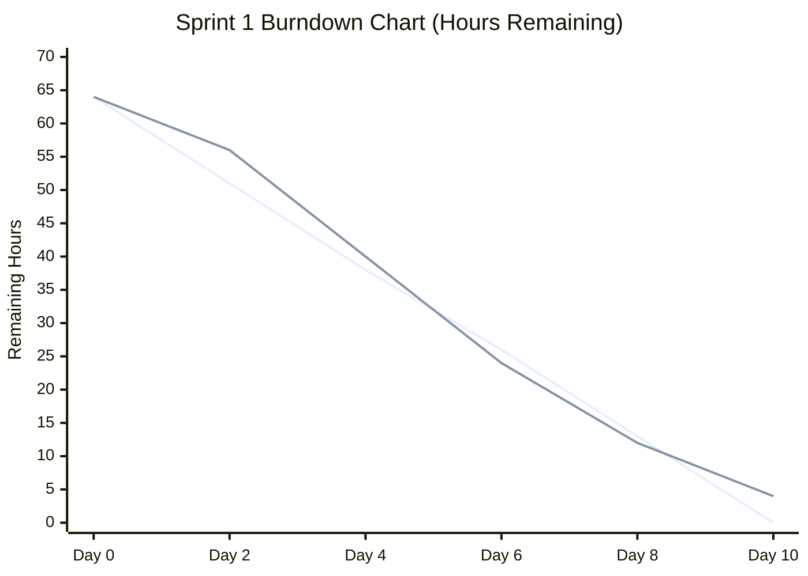

# PRODUCT BACKLOG & SPRINT 1 BACKLOG (AGILE / SCRUM)

> **Dự án:** Hệ thống Quản lý Nhà hàng Thực tế (Restaurant Management System)  
> **Học phần:** IT3180 — Nhập môn Công nghệ Phần mềm | **GVHD:** TS. Nguyễn Nhất Hải  
> **Quy ước Scrum (`Bai 03` P29):** Product Backlog sắp xếp theo giá trị MoSCoW; mỗi task trong Sprint Backlog được chia nhỏ để thời gian hoàn thành **≤ 2 ngày công**.

---

## 1. Danh mục Epics

| Mã Epic | Tên Epic | Giá trị nghiệp vụ cốt lõi | Sprint mục tiêu |
| :---: | :--- | :--- | :---: |
| **EP-01** | Khởi tạo Quy trình, Yêu cầu & Thiết kế | Thiết lập nền tảng QLDA, SCM, SRS chuẩn hóa và Kiến trúc/UI trước khi lập trình | Sprint 1 – 2 |
| **EP-02** | Xác thực, Phân quyền & Quản trị Hệ thống | Bảo mật RBAC (`ADMIN`, `STAFF`, `KITCHEN`) và quản lý danh mục, món, bàn, nhân sự | Sprint 2 |
| **EP-03** | Nghiệp vụ Sơ đồ Bàn & Gọi món POS | Sơ đồ bàn trực quan, chống mở trùng bàn (`@Version`), gọi món ≤ 3 chạm, chuyển/gộp bàn | Sprint 2 – 3 |
| **EP-04** | Điều phối Bếp Real-time (KDS) | Đẩy đơn tức thì (< 1s) qua WebSocket STOMP, FIFO, âm thanh, báo hết món 2 chiều | Sprint 3 |
| **EP-05** | Thanh toán VietQR & Báo cáo Doanh thu | Sinh mã VietQR động EMVCo CRC16, thanh toán tiền mặt, thống kê doanh thu & Top 10 món | Sprint 3 |
| **EP-06** | Kiểm thử Toàn diện, Đóng gói & Bảo trì | Đảm bảo chất lượng V&V (White-box, Black-box), Docker 1-click và tài liệu bảo vệ | Sprint 4 |

---

## 2. Product Backlog Đầy đủ (`US-01` → `US-22`)

| Story ID | Epic | User Story | Liên kết SRS | MoSCoW | SP | Sprint | Tiêu chí nghiệm thu chính (Acceptance Criteria) |
| :---: | :---: | :--- | :--- | :--- | :---: | :---: | :--- |
| **US-01** | EP-01 | Là PM/CM, tôi muốn chuẩn hóa repo Git, CI và bộ tài liệu kế hoạch/SCM để cả nhóm cộng tác chuẩn CNPM. | NFR-06 | Must | 3 | S1 | Root có `README`, `LICENSE`, `CHANGELOG`, `.github/*`, `PROJECT_MANAGEMENT_PLAN`, `SCM_PLAN`. |
| **US-02** | EP-01 | Là QA/Nhóm, tôi muốn có bản đặc tả `SRS v1.0` đầy đủ mô hình DFD, UML, FSM, ERD và RTM để thống nhất phạm vi trước khi thiết kế. | FR-01..22 | Must | 8 | S1 | Đủ 22 FR, 8 NFR định lượng, 6 Use Case chi tiết, 5 nhóm mô hình WebApp và ma trận RTM 100%. |
| **US-03** | EP-01 | Là UI/UX Lead, tôi muốn hoàn thành Wireframe → Style Guide → Figma Prototype và khảo sát 5 tiêu chí sử dụng để tối ưu POS/KDS. | NFR-03 | Must | 5 | S1–S2 | Có ảnh/link Wireframe đơn sắc, Figma Hi-Fi và bảng tổng hợp đánh giá từ ≥ 5 người dùng thử. |
| **US-04** | EP-02 | Là Nhân viên (Thu ngân/Bếp/Admin), tôi muốn đăng nhập bằng tài khoản cá nhân để truy cập đúng màn hình theo vai trò. | FR-01, FR-02, NFR-05 | Must | 5 | S2 | Đăng nhập trả về JWT hợp lệ; sai mật khẩu trả `401`; truy cập API sai quyền trả `403`. |
| **US-05** | EP-02 | Là Quản lý, tôi muốn tạo, sửa, khóa/mở khóa tài khoản nhân viên và gán vai trò để kiểm soát nhân sự. | FR-03 | Must | 3 | S2 | Admin tạo/cập nhật/vô hiệu hóa user; mật khẩu băm BCrypt; không tự xóa tài khoản Admin duy nhất. |
| **US-06** | EP-02 | Là Quản lý, tôi muốn thêm/sửa/xóa mềm danh mục và món ăn (tên, giá, ảnh, mô tả) để cập nhật thực đơn kịp thời. | FR-19, FR-20 | Must | 5 | S2 | CRUD danh mục và món ăn hoạt động; giá ≥ 0; xóa mềm không làm hỏng lịch sử hóa đơn cũ. |
| **US-07** | EP-02 | Là Quản lý, tôi muốn quản lý danh sách khu vực và bàn ăn (tên bàn, sức chứa, tầng/khu) để phản ánh đúng mặt bằng quán. | FR-04, FR-21 | Must | 3 | S2 | Tạo/sửa bàn theo khu vực; không xóa bàn đang có trạng thái `OCCUPIED` hoặc `WAITING_PAYMENT`. |
| **US-08** | EP-03 | Là Phục vụ, tôi muốn xem sơ đồ bàn theo khu vực với mã màu trạng thái trực quan để đón khách nhanh chóng. | FR-04 | Must | 3 | S2 | Hiển thị 4 màu trạng thái (`AVAILABLE`, `OCCUPIED`, `WAITING_PAYMENT`, `CLEANING`), tự cập nhật real-time. |
| **US-09** | EP-03 | Là Phục vụ, tôi muốn mở bàn cho khách và hệ thống chặn việc 2 người mở trùng cùng một bàn để tránh tạo đơn đè. | FR-05, NFR-02 | Must | 5 | S2 | Khi 2 request mở cùng bàn đồng thời, request thứ 2 nhận `409 Conflict` nhờ `@Version`, UI tự làm mới. |
| **US-10** | EP-03 | Là Phục vụ, tôi muốn tìm món nhanh theo tên/danh mục, chọn số lượng và ghi chú khẩu vị để gửi đơn chính xác trong ≤ 3 chạm. | FR-08, FR-09, NFR-03 | Must | 5 | S2 | Tìm kiếm tức thời; ghi chú riêng từng dòng món (vd: "ít cay"); gửi đơn tạo `ORDER` & `ORDER_ITEMS`. |
| **US-11** | EP-03 | Là Phục vụ, tôi muốn gọi thêm món vào bàn đang phục vụ hoặc hủy món khi bếp chưa nấu để xử lý thay đổi của khách. | FR-10, FR-11 | Must | 5 | S3 | Gọi thêm tạo batch món mới xuống bếp; chỉ hủy trực tiếp khi món ở trạng thái `PENDING`. |
| **US-12** | EP-03 | Là Phục vụ, tôi muốn chuyển bàn hoặc gộp đơn từ nhiều bàn thành một hóa đơn để phục vụ khách đổi chỗ/đi nhóm đông. | FR-06, FR-07 | Must | 5 | S3 | Chuyển bàn trống giữ nguyên đơn; gộp bàn cộng dồn danh sách món và giải phóng bàn nguồn an toàn. |
| **US-13** | EP-04 | Là Đầu bếp, tôi muốn nhận đơn mới tức thì (< 1s) trên màn hình KDS theo thứ tự FIFO kèm âm thanh và nháy viền cảnh báo. | FR-12, NFR-01 | Must | 8 | S3 | WebSocket STOMP `/topic/kds/orders` đẩy đơn < 1s; thẻ mới phát chuông & highlight; sắp xếp cũ nhất lên đầu. |
| **US-14** | EP-04 | Là Đầu bếp, tôi muốn chuyển trạng thái từng món (`Chờ làm → Đang nấu → Hoàn tất`) để báo phục vụ ra bàn lấy món. | FR-13, FR-14 | Must | 5 | S3 | Trạng thái món cập nhật real-time về POS kèm thông báo món sẵn sàng phục vụ. |
| **US-15** | EP-04 | Là Đầu bếp / Quản lý, tôi muốn bật/tắt trạng thái "Tạm hết món" và khóa ngay lập tức trên mọi màn hình POS đang mở. | FR-15 | Must | 5 | S3 | Broadcast `/topic/menu/availability` khóa nút đặt món trên POS trong < 1s, chặn API đặt món đã hết. |
| **US-16** | EP-04 | Là Phục vụ / Đầu bếp, tôi muốn màn hình tự động cảnh báo khi mất mạng LAN và tự kết nối lại, đồng bộ đủ đơn bị lỡ. | NFR-04 | Must | 3 | S3 | Heartbeat 10s; mất mạng hiện banner đỏ, giữ state đơn đang nhập; có mạng tự reconnect & sync lại. |
| **US-17** | EP-05 | Là Thu ngân, tôi muốn thanh toán bằng tiền mặt hoặc tạo mã VietQR động đúng số tiền hóa đơn để khách quét trả ngay. | FR-16, FR-17, NFR-08 | Must | 5 | S3 | Sinh chuỗi VietQR chuẩn EMVCo + CRC16 đúng; xác nhận thanh toán chuyển bàn sang `CLEANING`. |
| **US-18** | EP-05 | Là Quản lý, tôi muốn xem báo cáo doanh thu theo ngày/khoảng thời gian và biểu đồ Top 10 món bán chạy để ra quyết định nhập hàng. | FR-22 | Must | 5 | S3 | Tính đúng tổng doanh thu từ hóa đơn `PAID`, phân tách tiền mặt/VietQR, hiển thị Top 10 món. |
| **US-19** | EP-05 | Là Thu ngân, tôi muốn xem/in phiếu tạm tính, hóa đơn thanh toán và tra cứu lịch sử hóa đơn để đối soát khi khách hỏi. | FR-18 | Should | 3 | S3 | Có giao diện in CSS `@media print` rõ ràng; lọc lịch sử hóa đơn theo ngày, bàn, phương thức. |
| **US-20** | EP-02 | Là Quản lý, tôi muốn hệ thống ghi lại Audit Log cho thao tác hủy món đã nấu, đổi giá món hoặc xác nhận thanh toán để chống thất thoát. | FR-03, NFR-05 | Should | 3 | S3 | Lưu bảng `AUDIT_LOGS` (ai, làm gì, lúc nào, dữ liệu cũ/mới) và xem được trong Admin. |
| **US-21** | EP-05 | Là Thu ngân, tôi muốn áp dụng mã giảm giá (%) hoặc tách riêng một số món sang hóa đơn mới khi khách chia tiền. | FR-16 *(mở rộng)* | Could | 5 | S4 | Chỉ triển khai nếu hoàn thành 100% các mục Must-have trước giữa Sprint 4. |
| **US-22** | EP-06 | Là QA Lead / DevOps, tôi muốn hoàn tất kiểm thử White-box (JaCoCo ≥ 75%), Black-box và đóng gói Docker Compose 1-click. | NFR-06, NFR-07 | Must | 8 | S4 | `STP_v1.0.md` + CFG + BVA/DT + Maintenance Log; `docker compose up` chạy trọn hệ thống kèm seed data. |

---

## 3. Sprint 1 Backlog Chi tiết (Tuần 1 – Tuần 2)

> **Mục tiêu Sprint 1 (`BL-01: v0.1.0-srs`):** Hoàn thành nền tảng Quản lý Dự án, Quản lý Cấu hình (SCM), Đặc tả Yêu cầu Phần mềm (`SRS v1.0`) và Wireframe giao diện sơ bộ.  
> **Tổng Story Points cam kết:** `17 SP` (`US-01`, `US-02`, `US-03 phần 1`) — **Thời gian:** 14 ngày (10 ngày làm việc chính).

| Task ID | Thuộc Story | Mô tả công việc cụ thể (Task ≤ 2 ngày) | Người thực hiện | Ước lượng | Trạng thái |
| :---: | :---: | :--- | :--- | :---: | :---: |
| **T1.1** | US-01 | Dọn cấu trúc repo, khôi phục `LICENSE` & `README.md` ở root, cấu hình `.gitignore`, `.env.example` | Tuấn Anh | 4h | `Done` |
| **T1.2** | US-01 | Tạo `.github/ISSUE_TEMPLATE/*`, `PULL_REQUEST_TEMPLATE.md` & `.github/workflows/ci.yml` | Tuấn Anh | 4h | `Done` |
| **T1.3** | US-01 | Soạn `SCM_PLAN.md` (CI, 5 Baselines, Git Flow, SemVer, Change Control) & `CHANGELOG.md` | Tuấn Anh | 4h | `Done` |
| **T1.4** | US-01 | Soạn `PROJECT_MANAGEMENT_PLAN.md` (4P, WBS 4 Sprint, Gantt, Task Network, Risk-RMMM) | Quân | 8h | `Done` |
| **T1.5** | US-01 | Soạn `PRODUCT_BACKLOG.md` (Epics, 22 User Stories MoSCoW, Sprint 1 Backlog, Burndown) | Quân | 6h | `Done` |
| **T1.6** | US-02 | Khảo sát nghiệp vụ & phân tích/thương lượng yêu cầu (BR vs UR, 4 Actors, MoSCoW) | Nghĩa | 6h | `Done` |
| **T1.7** | US-02 | Đặc tả 22 Functional Requirements (`FR-01..22`), 8 NFR định lượng & 6 Use Case chi tiết | Nghĩa, Quân | 8h | `Done` |
| **T1.8** | US-02 | Vẽ bộ mô hình đặc tả WebApp: DFD (0/1), Use Case, Sequence (3 luồng), State FSM (2 máy), Activity/Swimlane, ERD, Navigation Map | Quân, Nghĩa | 8h | `Done` |
| **T1.9** | US-02 | Xây dựng Ma trận Truy xuất Yêu cầu (`RTM`) & kiểm tra chéo tính nhất quán toàn tài liệu | Nghĩa | 4h | `Done` |
| **T1.10** | US-03 | Phân tích người dùng/tác vụ (`Bai 07_2`) và phác thảo Wireframe Lo-Fi màn hình POS & KDS | Hải | 8h | `Done` |
| **T1.11** | US-03 | Rà soát tổng thể (FTR) hồ sơ `BL-01` và gắn tag `v0.1.0-srs` | Toàn nhóm | 4h | `Done` |

---

## 4. Theo dõi Tiến độ Sprint 1 (Burndown Chart)

| Ngày làm việc | Mốc thời gian | Giờ công còn lại (Lý tưởng) | Giờ công còn lại (Thực tế) | Ghi chú tiến độ |
| :---: | :--- | :---: | :---: | :--- |
| Ngày 0 | Khởi động Sprint 1 | 64h | 64h | Chốt đề tài, phân công 4 thành viên |
| Ngày 2 | Hết ngày 2 | 51h | 56h | Hoàn thành báo cáo đề xuất & slide mở đầu |
| Ngày 4 | Hết ngày 4 | 38h | 40h | Hoàn thành cấu trúc SCM, `.github/*`, `PROJECT_MANAGEMENT_PLAN` |
| Ngày 6 | Hết ngày 6 | 26h | 24h | Chốt `PRODUCT_BACKLOG` & phần FR/NFR của `SRS_v1.0` |
| Ngày 8 | Hết ngày 8 | 13h | 12h | Hoàn thành toàn bộ mô hình Mermaid (DFD, Sequence, FSM, ERD, RTM) |
| Ngày 10 | Kết thúc Sprint 1 | 0h | 4h *(còn T1.10–T1.11)* | Nghiệm thu Wireframe & đóng băng Baseline `v0.1.0-srs` |

---

## 5. Khung Ghi nhận Sprint 1 Review & Retrospective

### 5.1 Sprint 1 Review (Nghiệm thu)
- **Mục tiêu đạt được:** Đã chuẩn hóa cấu trúc Git repository và hoàn thiện đầy đủ hồ sơ Quản lý dự án, SCM và Đặc tả yêu cầu (`SRS v1.0` + RTM) bám sát chuẩn IT3180.
- **Phần còn lại chuyển tiếp đầu Sprint 2:** Hoàn tất Wireframe Lo-Fi → nâng cấp lên Figma Hi-Fi và thực hiện khảo sát đánh giá UI (`US-03`).

### 5.2 Sprint 1 Retrospective (Cải tiến quy trình)
- **Điểm làm tốt (Keep):** Thống nhất sớm phạm vi MoSCoW giúp tránh ôm đồm tính năng thừa (tích điểm, đa chi nhánh); chia rõ vai trò CNPM song song với vai trò kỹ thuật.
- **Điểm cần khắc phục (Improve):** Ở giai đoạn đầu có tình trạng dời file thủ công (`README.md`, `LICENSE`) làm sai cấu trúc root và mới chỉ có 1 người commit. Từ Sprint 2, **bắt buộc cả 4 thành viên làm việc trên nhánh `feature/*` riêng và tạo PR qua review chéo**.
