# KẾ HOẠCH QUẢN LÝ DỰ ÁN PHẦN MỀM (PROJECT MANAGEMENT PLAN)

> **Dự án:** Hệ thống Quản lý Nhà hàng Thực tế (Restaurant Management System)  
> **Học phần:** Nhập môn Công nghệ Phần mềm (IT3180) — Trường CNTT&TT, Đại học Bách khoa Hà Nội  
> **Giảng viên hướng dẫn:** TS. Nguyễn Nhất Hải  
> **Phiên bản tài liệu:** `v1.0` (Baseline `BL-01`) — **Ngày cập nhật:** Sprint 1 (Tuần 2)

---

## 1. Tổng quan, Mục tiêu & Phạm vi Dự án

### 1.1 Bối cảnh & Bài toán
Tại các nhà hàng ăn uống phục vụ tại chỗ (Dine-in) quy mô vừa và nhỏ (20–50 bàn), quy trình ghi phiếu giấy và báo miệng gây ra ba điểm nghẽn nghiêm trọng trong giờ cao điểm:
1. **Độ trễ & sai sót order:** Phục vụ chạy giữa sảnh và bếp mất 3–5 phút/lượt, chữ viết tay dễ đọc nhầm hoặc sót ghi chú khẩu vị.
2. **Bất đồng bộ Bếp – Sảnh:** Bếp hết món nhưng phục vụ không biết; món nấu xong không báo kịp ra sảnh.
3. **Thanh toán chậm & khó đối soát:** Tính nhầm tiền mặt hoặc đối soát chuyển khoản QR tĩnh thủ công dễ gian lận.

### 1.2 Mục tiêu Đo lường được
- **Hiệu năng đồng bộ thời gian thực:** Truyền thông điệp đơn hàng POS ↔ KDS qua WebSocket STOMP đạt độ trễ **< 1.000 ms (p95)** trong mạng LAN.
- **Tối ưu thao tác POS:** Chọn bàn → chọn món → gửi bếp hoàn thành trong **≤ 3 lần chạm**, kích thước nút chạm **≥ 44×44 px**.
- **Toàn vẹn dữ liệu đồng thời:** Chặn **100%** tình huống 2 nhân viên mở trùng 1 bàn bằng Optimistic Locking (`@Version`).
- **Tự động hóa thanh toán:** Sinh mã VietQR động chuẩn NAPAS EMVCo (CRC16-CCITT) khớp đúng số tiền và mã đơn.
- **Chất lượng & Quy trình CNPM:** Đạt **≥ 75% Branch Coverage** cho tầng Service lõi; đầy đủ hồ sơ Agile/Scrum, SCM, SRS, SDD, Test Plan & Maintenance Log.

### 1.3 Phạm vi theo MoSCoW
- **Must-Have:** Đăng nhập JWT + RBAC (`ADMIN`, `STAFF`, `KITCHEN`); Sơ đồ bàn + `@Version` Optimistic Locking; POS gọi món + ghi chú + chuyển/gộp bàn; KDS real-time + âm thanh + FIFO + heartbeat/auto-reconnect; Đồng bộ trạng thái "Hết món" tức thì; Thanh toán tiền mặt & VietQR động; Admin CRUD Menu/Bàn/Nhân viên + Thống kê doanh thu & Top 10 món; Docker Compose 1-click + `seed.sql`.
- **Should-Have:** Xem/in hóa đơn tạm tính & thanh toán; Tra cứu lịch sử hóa đơn; Audit Log cho thao tác nhạy cảm.
- **Could-Have *(chỉ làm nếu dư thời gian Sprint 4)*:** Voucher giảm giá đơn giản, tách hóa đơn lẻ theo món.
- **Won't-Have:** Tích điểm thành viên (Membership/Loyalty), đa chi nhánh (Multi-tenant), quản lý kho nguyên liệu/NCC, chấm công khuôn mặt, webhook tự động đối soát biến động số dư ngân hàng thật.

---

## 2. Tổ chức Nhân sự, Mô hình 4P & Giao tiếp Nhóm

Theo **Chương 4 (Quản lý Dự án Phần mềm)**, dự án được quản lý xoay quanh 4 yếu tố cốt lõi (**4P: People – Product – Process – Project**), trong đó **Con người** là yếu tố quyết định.

### 2.1 Phân công Vai trò Kỹ thuật & Vai trò Quy trình CNPM (Nhóm 1 — 5 Thành viên)

| Thành viên | MSSV | Vai trò trong nhóm / Quy trình CNPM | Trách nhiệm quy trình CNPM | Phân hệ kỹ thuật phụ trách |
| :--- | :---: | :--- | :--- | :--- |
| **Đặng Minh Quân** | `202416323` | **Nhóm trưởng** — Phụ trách lập kế hoạch & thiết kế CSDL | • Lập & theo dõi WBS, Gantt, Sprint Backlog, Burndown • Điều phối Daily Standup, Sprint Review/Retro • Giám sát Risk Register & RMMM | • Thiết kế CSDL (ERD, DDL 3NF) & `SDD_v1.0.md` • Backend Core (Spring Boot): Quản lý bàn (`@Version`), chuyển/gộp bàn ACID, `OrderService`, `KdsService`, kênh WebSocket STOMP |
| **Đào Trần Hoàng Hải** | `202416190` | **Thành viên** — Phụ trách thiết kế giao diện & trải nghiệm người dùng | • Phân tích người dùng & tác vụ (ISO 9241-210) • Thiết kế Wireframe → Style Guide → Figma Prototype • Tổ chức khảo sát đánh giá UI (5 thuộc tính) | • Frontend POS (`FloorMapPage`, `OrderPadPage`, `usePosCart`, `TableTransferMergeModal`) • Frontend KDS (`KdsBoardPage` FIFO, âm thanh, `useStompClient` reconnect) |
| **Vũ Tuấn Anh** | `202416635` | **Thành viên** — Phụ trách quản lý cấu hình (Git, CI, Docker) | • Quản trị Git Flow, Branch/PR Protection, Tags/Baselines • Duy trì GitHub Actions CI & `.github/` templates • Chủ trì kiểm soát thay đổi (Change Control) | • Backend Auth (JWT + RBAC) & Admin APIs (`UserService`, `MenuService`, `AreaService`, `CategoryService`) • Frontend Admin Portal CRUD & Đóng gói `docker-compose.yml`, `Dockerfile`, `seed.sql` |
| **Bùi Đại Nghĩa** | `202416302` | **Thành viên** — Phụ trách kiểm thử chất lượng & biên soạn tài liệu | • Chủ trì tài liệu `SRS_v1.0`, RTM, `STP_v1.0` & `MAINTENANCE_LOG.md` • Thiết kế White-box (CFG) & Black-box Test Cases • Tổng hợp báo cáo BTL cuối kỳ & cẩm nang bảo vệ | • Kiểm thử chéo độc lập (`Bai 09` P11): Toàn bộ bộ test Backend JUnit 5 (JaCoCo ≥ 75% Branch, Concurrency, STOMP, CRC16) & Frontend Vitest |
| **Nguyễn Đăng Khôi** | `202416535` | **Thành viên** — Phụ trách phân tích nghiệp vụ, VietQR & thống kê | • Phối hợp khảo sát nghiệp vụ, đặc tả Use Case trong `SRS_v1.0.md` • Tham gia đề xuất giải pháp `ADR-0004` (VietQR EMVCo) & kiểm tra đối soát nghiệm thu | • Module sinh mã VietQR động NAPAS EMVCo CRC16 (`Crc16Util`, `EmvCoVietQrBuilder`, `PaymentService`, `SettingService`) • API & UI Thanh toán (`PaymentModal`, `PrintableReceipt`, `OrderHistoryPage`), Thống kê doanh thu / Top 10 & Audit Log *(kiểm thử chéo bởi Nghĩa)* |

### 2.2 Mô hình Giao tiếp & Phối hợp (`Bai 04` P19–20)
Nhóm áp dụng **mô hình giao tiếp Mở (Open Paradigm)** kết hợp **Chính thức & Phi chính thức**:
- **Daily Standup (15 phút, 21:00 tối thứ 2–4–6 hoặc async qua Discord):** Trả lời 3 câu hỏi: *Hôm qua làm gì? Hôm nay làm gì? Có vướng mắc (blocker) nào không?*
- **Giao tiếp kỹ thuật chính thức:** Mọi yêu cầu tính năng, báo lỗi, thay đổi phạm vi đều tạo thành **GitHub Issue** gắn nhãn và chỉ được đưa vào nhánh `develop` thông qua **Pull Request có Code Review Checklist**.
- **Sprint Planning / Review / Retrospective:** Tổ chức cố định vào cuối mỗi chu kỳ 2 tuần để nghiệm thu sản phẩm chạy được (Working Software) và cập nhật Baseline.

---

## 3. Phân rã Công việc (WBS) & Ước lượng Công sức (Estimation)

### 3.1 Cấu trúc Phân rã Công việc (WBS) — 4 Sprint (8 Tuần)

| Mã WBS | Gói công việc / Tác vụ chính | Sprint | Người chính | Review / Test chéo | Story Points | Ước lượng (Giờ công) | Sản phẩm bàn giao (Deliverables) |
| :---: | :--- | :---: | :--- | :--- | :---: | :---: | :--- |
| **1.1** | Chuẩn hóa Repo, SCM Plan, GitHub Templates & CI | S1 | Tuấn Anh | Quân | 3 | 12h | `SCM_PLAN.md`, `.github/*`, `CHANGELOG.md`, `README.md` |
| **1.2** | Lập Kế hoạch Dự án, WBS, Estimation & Risk RMMM | S1 | Quân | Nghĩa | 3 | 14h | `PROJECT_MANAGEMENT_PLAN.md`, `PRODUCT_BACKLOG.md` |
| **1.3** | Khảo sát, Đặc tả Yêu cầu & Mô hình hóa (`SRS v1.0`) | S1 | Nghĩa, Khôi | Quân, Hải | 8 | 26h | `SRS_v1.0.md` (DFD, Use Case, Sequence, FSM, ERD, RTM) |
| **1.4** | Phân tích người dùng & Wireframe Lo-Fi sơ bộ | S1 | Hải | Nghĩa | 3 | 12h | Wireframe POS/KDS ban đầu, Swimlane workflow |
| **2.1** | Thiết kế Kiến trúc (`SDD v1.0`), Patterns & DDL 3NF | S2 | Quân, Tuấn Anh | Nghĩa, Khôi | 5 | 20h | `SDD_v1.0.md`, `schema.sql`, `seed.sql` |
| **2.2** | Figma Hi-Fi Prototype & Khảo sát đánh giá UI (5 tiêu chí) | S2 | Hải | Quân | 5 | 18h | Figma Prototype + Báo cáo Đánh giá UI |
| **2.3** | Backend Auth JWT/RBAC, Admin CRUD APIs & Docker Base | S2 | Tuấn Anh | Quân | 8 | 22h | `AuthController`, `AdminMenuController`, `docker-compose.yml` |
| **2.4** | Backend Table/Order Core + Optimistic Locking + Unit Test S2 | S2 | Quân | Nghĩa | 8 | 22h | `TableService` (`@Version`), `OrderService`, JUnit5 tests |
| **2.5** | Frontend khung App, Login, Sơ đồ bàn POS & Admin cơ bản | S2 | Hải, Tuấn Anh | Nghĩa | 8 | 22h | UI Login, Sơ đồ bàn POS, trang CRUD Menu Admin |
| **3.1** | WebSocket STOMP POS ↔ KDS + Đồng bộ "Hết món" + Reconnect | S3 | Quân, Hải | Tuấn Anh | 8 | 26h | `WebSocketConfig`, STOMP Topics, UI KDS FIFO + âm thanh |
| **3.2** | Module Thanh toán Tiền mặt & VietQR động (EMVCo CRC16) | S3 | Khôi | Nghĩa | 5 | 20h | `VietQRPaymentStrategy`, `CashPaymentStrategy`, UI Thanh toán |
| **3.3** | API & Dashboard Thống kê Doanh thu, Top 10 món, Audit Log | S3 | Khôi, Tuấn Anh | Nghĩa | 5 | 18h | `ReportController`, Dashboard biểu đồ Admin |
| **3.4** | Kiểm thử Tích hợp Sprint 3 (Concurrency, STOMP, VietQR) | S3 | Nghĩa | Quân, Hải | 5 | 20h | Bộ test tích hợp `MockMvc` / WebSocket STOMP |
| **4.1** | Kiểm thử White-box (CFG, JaCoCo ≥ 75%) & Black-box (BVA/DT) | S4 | Nghĩa | Toàn nhóm | 8 | 28h | `STP_v1.0.md`, JaCoCo Report, bảng Test Cases |
| **4.2** | Sửa lỗi (Bug fixing), Refactoring & Kiểm thử hồi quy | S4 | Toàn nhóm | Chéo vai trò | 5 | 24h | PR `refactor:` & `fix:`, Maintenance/Bug Log |
| **4.3** | Hoàn thiện Docker Compose 1-click & E2E Demo Verification | S4 | Tuấn Anh, Hải | Khôi, Nghĩa | 3 | 14h | Hệ thống chạy ổn định qua `docker compose up` |
| **4.4** | Tổng kết Hồ sơ CNPM, Báo cáo cuối kỳ & Slide Bảo vệ | S4 | Nghĩa, Khôi, Toàn nhóm | Quân | 5 | 22h | Báo cáo tổng kết + Slide bảo vệ + Tag `v1.0.0` |
| **Tổng** | **Toàn dự án (4 Sprint — 8 Tuần)** | **S1–S4** | **5 thành viên** | **100% Review chéo** | **92 SP** | **340h** | **Hệ thống + Hồ sơ CNPM hoàn chỉnh** |

### 3.2 Phân bổ Công sức Theo Pha CNPM (`Bai 04` P42)
Theo khuyến nghị trong slide Bài 04 (40–50% phân tích/thiết kế, 15–20% lập trình, 30–40% kiểm thử & cài đặt), nhóm phân bổ nguồn lực như sau để tránh lỗi dồn toàn bộ kiểm thử sang cuối kỳ:

| Nhóm hoạt động CNPM | Giờ công dự kiến | Tỷ trọng | Cách triển khai thực tế |
| :--- | :---: | :---: | :--- |
| **1. Front-end CNPM** *(Khảo sát, SRS, Thiết kế kiến trúc, UI/UX, QLDA)* | **138h** | **40.6%** | Tập trung ở Sprint 1–2; cập nhật liên tục khi có Change Request |
| **2. Xây dựng phần mềm** *(Coding Backend, Frontend, WebSocket, VietQR)* | **86h** | **25.3%** | Chia đều từ Sprint 2–3 theo module độc lập, áp dụng Code Review Checklist |
| **3. Kiểm thử, SQA & Đóng gói** *(Unit/Integration Test song song S2–S3, White/Black-box S4, Docker, Bảo trì)* | **116h** | **34.1%** | **Chạy song song từ Sprint 2** (không đợi đến Sprint 4 mới test) |
| **Tổng cộng** | **340h** | **100.0%** | Trung bình ~8.5 giờ/tuần/thành viên trong 8 tuần |

---

## 4. Lịch biểu, Mạng lưới Tác vụ & Cột mốc SQA

### 4.1 Lịch trình 8 Tuần (Gantt Chart)

| WBS | Gói công việc | T1 | T2 | T3 | T4 | T5 | T6 | T7 | T8 |
| :---: | :--- | :---: | :---: | :---: | :---: | :---: | :---: | :---: | :---: |
| `1.1–1.2` | Chuẩn hóa SCM, PMP, Backlog & Rủi ro | ██ | ██ | | | | | | |
| `1.3–1.4` | Đặc tả `SRS v1.0`, Mô hình hóa & Wireframe Lo-Fi | ██ | ██ | | | | | | |
| `2.1–2.2` | Thiết kế `SDD v1.0`, DDL 3NF, Figma & Đánh giá UI | | | ██ | ██ | | | | |
| `2.3–2.5` | Core Backend (JWT, Table `@Version`, Order) + UI POS/Admin | | | ██ | ██ | | | | |
| `3.1` | Kênh WebSocket STOMP (POS ↔ KDS) & Đồng bộ Hết món | | | | | ██ | ██ | | |
| `3.2–3.3` | Thanh toán VietQR động (EMVCo), Báo cáo Doanh thu & Audit Log | | | | | ██ | ██ | | |
| `3.4` | Kiểm thử Tích hợp (Concurrency, STOMP, VietQR) | | | | ██ | ██ | ██ | | |
| `4.1–4.2` | Kiểm thử White-box/Black-box, Refactoring & Regression | | | | | | | ██ | ██ |
| `4.3–4.4` | Đóng gói Docker 1-click, Hồ sơ tổng kết & Bảo vệ | | | | | | | ██ | ██ |
| **Mốc SQA** | **Kiểm duyệt Baseline** | | `BL-01` | | `BL-02/03` | | `BL-04` | | `BL-05` |

### 4.2 Mạng lưới Phụ thuộc Tác vụ & Điểm SQA (Task Dependency Network)

```mermaid
flowchart LR
    W11["1.1 SCM & CI Setup"] --> W23["2.3 Auth, Admin & Docker"]
    W12["1.2 PMP & Risk Plan"] --> W13["1.3 SRS v1.0 & RTM"]
    W13 --> SQA1{{"BL-01: v0.1.0-srs Review"}}
    W14["1.4 Lo-Fi Wireframe"] --> W22["2.2 Figma & UI Eval"]
    SQA1 --> W21["2.1 SDD v1.0 & DDL 3NF"]
    SQA1 --> W22
    W21 --> W23
    W21 --> W24["2.4 Table @Version & Order Core"]
    W22 --> W25["2.5 POS & Admin UI Base"]
    W23 --> W25
    W24 --> SQA2{{"BL-02/03: v0.3.0-alpha Review"}}
    W25 --> SQA2
    SQA2 --> W31["3.1 WebSocket STOMP KDS & Out-of-Stock"]
    SQA2 --> W32["3.2 VietQR EMVCo & Cash Payment"]
    SQA2 --> W33["3.3 Revenue Report & Audit Log"]
    W31 --> W34["3.4 Integration Testing"]
    W32 --> W34
    W33 --> W34
    W34 --> SQA3{{"BL-04: v0.9.0-rc Review"}}
    SQA3 --> W41["4.1 White-box CFG & Black-box BVA/DT"]
    W41 --> W42["4.2 Bug Fix, Refactor & Regression"]
    W42 --> W43["4.3 Docker 1-Click & E2E Demo"]
    W43 --> W44["4.4 Final Docs & Defense"]
    W44 --> SQA4{{"BL-05: v1.0.0 Final Release"}}
```

---

## 5. Quản lý Rủi ro Dự án & Kế hoạch RMMM (`Bai 04` P49–62)

### 5.1 Phương pháp Đánh giá Mức độ Rủi ro (`RE = P × C`)
- **Xác suất xảy ra (`P`):** Ước lượng theo phần trăm (`0.00` – `1.00`).
- **Tác động (`I`):** Thang 1–5 (`1`: không đáng kể; `3`: trễ Sprint cục bộ; `5`: hỏng kịch bản demo/nghiệm thu).
- **Chi phí tổn thất (`C`):** Số giờ công cần để khắc phục nếu rủi ro xảy ra.
- **Mức độ rủi ro tổng cộng (`RE`):** $RE = P \times C$ (đơn vị: giờ công kỳ vọng). Các rủi ro được sắp xếp theo `RE` giảm dần để ưu tiên kiểm soát.

### 5.2 Bảng Đăng ký Rủi ro & Kế hoạch RMMM (Mitigation – Monitoring – Management)

| Mã | Rủi ro | Loại | `P` | `I` (1–5) | `C` (giờ) | `RE = P×C` | Giảm thiểu (Mitigation) | Giám sát (Monitoring) | Quản lý / Dự phòng (Management) |
| :---: | :--- | :--- | :---: | :---: | :---: | :---: | :--- | :--- | :--- |
| **RSK-01** | **Rớt mạng LAN / mất kết nối WebSocket STOMP** khiến KDS bị sót hoặc trễ đơn > 1s | Hiệu năng | 0.40 | 5 | 20h | **8.0h** | Bật STOMP heartbeat (10s/10s), tự reconnect exponential backoff; đồng bộ lại snapshot đơn đang active ngay khi reconnect. | Log tỷ lệ reconnect và đo latency STOMP trong Integration Test Sprint 3. | Hiển thị banner cảnh báo đỏ trên POS/KDS; kích hoạt fallback fetch REST `/api/v1/kds/orders` mỗi 5s khi socket đứt quá 10s. |
| **RSK-02** | **Lệch hợp đồng API (API Contract Drift)** giữa Frontend (Hải/Khôi) và Backend (Quân/Tuấn Anh/Khôi) | Kỹ thuật / Giao tiếp | 0.45 | 4 | 16h | **7.2h** | Chốt OpenAPI/Swagger DTO schema trước khi code Sprint 2; chia sẻ chung trong `SDD_v1.0.md`. | Kiểm tra PR đụng DTO/Controller; chạy test hợp đồng FE–BE cuối tuần 4 & 6. | Tổ chức cặp đôi debug (Pair Programming) ngay trong ngày, ưu tiên cập nhật TypeScript interfaces theo OpenAPI chuẩn. |
| **RSK-03** | **Trễ tiến độ do làm quen Spring Boot 3 Security/WebSocket** | Tiến độ | 0.35 | 4 | 20h | **7.0h** | Dùng mẫu code chuẩn hóa của Spring Boot 3, tách nhỏ task ≤ 2 ngày; tạo skeleton chạy được ngay đầu Sprint 2. | Theo dõi Burndown Chart hằng ngày; cảnh báo nếu task quá hạn 24h. | Điều phối Quân/Tuấn Anh hỗ trợ kỹ thuật; cắt bớt các mục *Could-have* (Voucher, Tách hóa đơn lẻ) để bảo vệ *Must-have*. |
| **RSK-04** | **Race condition khi 2 nhân viên mở trùng bàn / gọi đơn đồng thời** | Toàn vẹn dữ liệu | 0.30 | 5 | 18h | **5.4h** | Thiết kế sẵn cột `version` trên bảng `DINING_TABLES` & `ORDERS`, bắt ngoại lệ `OptimisticLockingFailureException` trả về HTTP `409 Conflict`. | Viết Integration Test bắn 2 luồng song song (`CompletableFuture` / `ExecutorService`) ở Sprint 2. | Frontend bắt mã `409`, hiển thị thông báo rõ ràng và tự reload lại sơ đồ bàn mới nhất. |
| **RSK-05** | **Phình phạm vi (Scope Creep)** do thêm tính năng ngoài cốt lõi (tích điểm, tách bill phức tạp) | Phạm vi | 0.40 | 3 | 12h | **4.8h** | Khóa phạm vi MoSCoW ngay tại `BL-01`; mọi đề xuất mới bắt buộc đi qua Change Request (`CR-XX`). | PM rà soát Backlog mỗi cuối tuần, từ chối tính năng không thuộc *Must-have*. | Đẩy tính năng phát sinh vào mục *Could-have / Future Work* trong báo cáo cuối kỳ. |
| **RSK-06** | **Sai chuẩn payload VietQR NAPAS EMVCo / sai CRC16** khiến app ngân hàng không quét được | Nghiệp vụ | 0.25 | 4 | 16h | **4.0h** | Cài đặt chuẩn EMVCo Tag-Length-Value + CRC16-CCITT (`0x1021`), viết bộ Unit Test đối chiếu chuỗi mẫu chuẩn NAPAS. | Test quét thực tế bằng tối thiểu 2 ứng dụng ngân hàng khác nhau ở Sprint 3. | Cung cấp chế độ fallback hiển thị QR tĩnh kèm nội dung chuyển khoản bắt buộc + nút xác nhận tiền mặt. |
| **RSK-07** | **Xung đột Git / mất đồng bộ tài liệu hoặc code giữa 5 thành viên** | Cấu hình (SCM) | 0.30 | 3 | 10h | **3.0h** | Áp dụng nhánh `feature/*` ngắn ngày, PR bắt buộc review, CI kiểm tra hygiene & build tự động. | Theo dõi git graph và trạng thái GitHub Actions trên mỗi PR. | Phụ trách cấu hình (Tuấn Anh) hỗ trợ rebase/resolve conflict có kiểm thử hồi quy kèm theo. |
| **RSK-08** | **Khác biệt môi trường chạy giữa macOS và Windows khi demo bảo vệ** | Triển khai | 0.20 | 4 | 12h | **2.4h** | Container hóa toàn bộ (PostgreSQL, Spring Boot, React Nginx) qua `docker-compose.yml` + biến môi trường `.env.example`. | Test chạy `docker compose up --build` trên cả macOS (ARM64) và Windows/Linux trước Sprint 4. | Chạy demo trực tiếp trên máy đã verify từ trước và chuẩn bị bản build JAR + Vite cục bộ dự phòng. |
