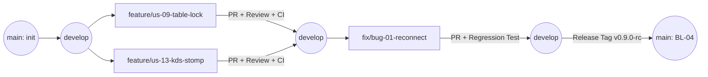
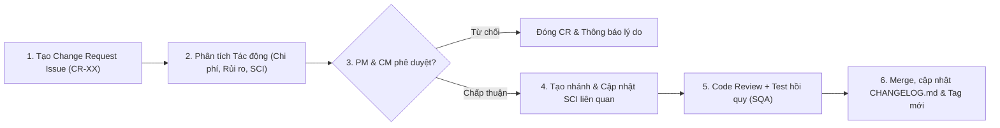

# KẾ HOẠCH QUẢN LÝ CẤU HÌNH PHẦN MỀM (SCM PLAN)

> **Dự án:** Hệ thống Quản lý Nhà hàng Thực tế (Restaurant Management System)  
> **Học phần:** Nhập môn Công nghệ Phần mềm (IT3180) — Chương 5: Quản lý Cấu hình Phần mềm  
> **Configuration Manager:** Vũ Tuấn Anh (`202416635`) | **Tham chiếu chuẩn:** IEEE 828 / IEEE 1042 (`Bai 05` P13)

---

## 1. Mục đích & Phạm vi SCM
Quản lý Cấu hình Phần mềm (Software Configuration Management — SCM) bảo đảm mọi sản phẩm tạo ra trong suốt vòng đời dự án (tài liệu, mô hình, mã nguồn, kịch bản kiểm thử, cấu hình triển khai) đều được **định danh duy nhất**, **kiểm soát phiên bản**, **kiểm soát thay đổi có đánh giá tác động**, và **khôi phục được về trạng thái ổn định gần nhất** khi có sự cố (`Bai 05` P16).

---

## 2. Nhận dạng Mục Cấu hình (SCI / CI Identification)

Theo `Bai 05` P18–22, không đưa toàn bộ mọi tệp tạm trên máy cá nhân vào kho lưu trữ (`.venv/`, `Slide/`, `Tài liệu/`, `.DS_Store`, bản PDF xuất nặng > 10 MB được loại trừ qua `.gitignore`). Chỉ các thực thể chính thức sau được định danh là **Mục Cấu hình Phần mềm (SCI)**:

| Mã SCI | Nhóm mục cấu hình | Đường dẫn / Tệp đại diện trong kho lưu trữ | Chủ sở hữu (Owner) | Quy tắc đặt tên & Phiên bản |
| :---: | :--- | :--- | :--- | :--- |
| **SCI-01** | Tài liệu Quản lý & SCM | `README.md`, `CHANGELOG.md`, `docs/01-project-management/*.md` | Quân & Tuấn Anh | Chữ hoa `TEN_TAI_LIEU.md`, cập nhật theo Baseline |
| **SCI-02** | Đặc tả Yêu cầu (SRS) | `docs/02-requirements/SRS_v1.0.md` | Nghĩa | Kèm hậu tố phiên bản `_vX.Y.md` |
| **SCI-03** | Tài liệu Thiết kế (SDD & UI) | `docs/03-design/SDD_v1.0.md`, `docs/03-design/schema.sql`, `seed.sql` | Quân & Hải | Tách riêng kiến trúc, DDL và bằng chứng UI |
| **SCI-04** | Tài liệu QA & Bảo trì | `docs/04-testing-qa/STP_v1.0.md`, `MAINTENANCE_LOG.md` | Nghĩa | Gắn với mã `TC-XX` và `BUG-XX` |
| **SCI-05** | Mã nguồn Backend | `backend/src/**`, `backend/pom.xml` | Quân, Tuấn Anh, Nghĩa | Package `com.hust.rms.*`, Google Java Style |
| **SCI-06** | Mã nguồn Frontend | `frontend/src/**`, `frontend/package.json` | Hải, Tuấn Anh | TypeScript strict, ESLint + Prettier |
| **SCI-07** | Bộ kiểm thử tự động | `backend/src/test/**`, `frontend/src/**/*.test.tsx` | Toàn nhóm *(chéo tác giả)* | Đặt tên `*Test.java` / `*.test.tsx` |
| **SCI-08** | Cấu hình Hạ tầng & CI | `docker-compose.yml`, `Dockerfile`, `.env.example`, `.github/**` | Tuấn Anh | Cấm commit file `.env` chứa secret thật |

---

## 3. Quản lý Đường cơ sở (Baselines) & Đánh số Phiên bản

### 3.1 Định danh Phiên bản (`Bai 05` P55–58)
Dự án kết hợp **Đánh số theo chuỗi (Sequence-based Semantic Versioning)** và **Nhãn giai đoạn ổn định (Stage-based identifiers)**:

$$\text{vMAJOR.MINOR.PATCH[-stage]}$$

- `MAJOR`: Tăng khi thay đổi lớn làm phá vỡ tương thích kiến trúc hoặc hoàn thành bản phát hành chính thức (`v1.0.0`).
- `MINOR`: Tăng theo từng Baseline hoàn chỉnh tính năng mới giữa các Sprint (`0.1`, `0.2`, `0.3`...).
- `PATCH`: Tăng khi sửa lỗi (Revision/Hotfix) không đổi chức năng đã đặc tả (`Bai 05` P32).
- `-stage`: `-srs`, `-design`, `-alpha` (thử nghiệm nội bộ), `-rc` (Release Candidate trước khi bảo vệ).

### 3.2 Danh mục 5 Đường cơ sở (Baselines) Dự kiến

| Mã Baseline | Git Tag | Thời điểm | Các SCI được đóng băng | Tiêu chí kiểm duyệt kỹ thuật (FTR / SQA Gate) | Người phê duyệt |
| :---: | :--- | :---: | :--- | :--- | :--- |
| **BL-01** | `v0.1.0-srs` | Cuối Sprint 1 (T2) | `SCI-01`, `SCI-02`, `.github/*` | Đủ 22 FR, 8 NFR, mô hình DFD/UML/ERD, RTM 100%; `repo-hygiene` CI xanh | Quân & Tuấn Anh |
| **BL-02** | `v0.2.0-design` | Giữa Sprint 2 (T3) | `SCI-03` (`SDD v1.0`, DDL, Figma) | Schema đạt chuẩn 3NF, có `@Version`, đủ 3 Design Patterns, UI qua 5 tiêu chí | Quân & Hải |
| **BL-03** | `v0.3.0-alpha` | Cuối Sprint 2 (T4) | `SCI-05`, `SCI-06`, `SCI-08` (Core) | Chạy được Docker DB + JWT + Sơ đồ bàn + Admin CRUD; JUnit core pass | Tuấn Anh & Quân |
| **BL-04** | `v0.9.0-rc` | Cuối Sprint 3 (T6) | Toàn bộ tính năng *Must-have* | STOMP KDS < 1s, đồng bộ Hết món, VietQR EMVCo quét đúng, báo cáo doanh thu | Toàn nhóm |
| **BL-05** | `v1.0.0` | Cuối Sprint 4 (T8) | Toàn bộ `SCI-01` → `SCI-08` | JaCoCo ≥ 75% Service, Black-box/White-box pass 100%, `docker compose up` OK | Toàn nhóm & GVHD |

---

## 4. Chiến lược Phân nhánh & Quy ước Git (Version Control)

### 4.1 Mô hình Nhánh Git Flow Tối giản (`Bai 05` P52–54)
- **`main`:** Nhánh sản xuất / phát hành chính thức. Chỉ nhận merge từ `develop` (hoặc `hotfix/*`) tại các mốc Baseline. Mọi commit trên `main` đều ở trạng thái chạy được.
- **`develop`:** Nhánh tích hợp chính trong suốt quá trình phát triển các Sprint.
- **`feature/<us-id>-<short-desc>`:** Nhánh tính năng tách từ `develop` (vd: `feature/us-09-table-optimistic-lock`).
- **`fix/<bug-id>-<short-desc>`:** Nhánh sửa lỗi tách từ `develop` (hoặc từ `main` nếu là `hotfix/*`).
- **`docs/<topic>`:** Nhánh cập nhật tài liệu đặc tả, thiết kế hoặc báo cáo.

### 4.2 Quy ước Commit & Pull Request
- **Conventional Commits:** `<type>(<scope>): <mô tả ngắn gọn>`
  - `feat:` thêm tính năng mới | `fix:` sửa lỗi | `docs:` tài liệu | `refactor:` tái cấu trúc không đổi hành vi (`Bai 08` P33) | `test:` bổ sung unit/integration test | `chore:` cấu hình build, Docker, CI.
- **Quy tắc bắt buộc khi mở PR:**
  1. Gắn liên kết GitHub Issue (`Closes #...`).
  2. Điền đầy đủ `PULL_REQUEST_TEMPLATE.md` (bao gồm **Code Review Checklist Chương 8**).
  3. **Bắt buộc ≥ 1 thành viên khác tác giả** review & approve, và **CI workflow (`repo-hygiene`, `backend-ci`, `frontend-ci`) xanh 100%**.
  4. **Đảm bảo đóng góp minh bạch:** Cả 5 thành viên đều có commit và Pull Request thực tế trên lịch sử Git của kho lưu trữ.

---

## 5. Quy trình Kiểm soát Thay đổi (Change Control Process — `Bai 05` P64–67)

Khi một yêu cầu thay đổi phát sinh sau khi đã đóng băng Baseline (ví dụ: đổi cấu trúc bảng CSDL, bổ sung trường DTO, đổi phạm vi tính năng), nhóm tuân thủ quy trình 6 bước sau thay vì tự ý sửa thẳng:

### Báo cáo Trạng thái Cấu hình (Status Reporting — `Bai 05` P40)
Mọi thay đổi sau Baseline đều phải truy xuất được 4 câu hỏi thông qua `CHANGELOG.md` và lịch sử PR/Issue trên GitHub:
1. **What happened?** Thay đổi cụ thể ở SCI nào (liên kết `CR-XX` / `PR-#`).
2. **Who did it?** Tác giả thực hiện và người review/phê duyệt.
3. **When did it happen?** Thời điểm merge và phiên bản/Baseline áp dụng.
4. **What else will be affected?** Các module, test cases và tài liệu khác chịu tác động lan truyền (ripple effect) đã được kiểm thử lại.
