# TÀI LIỆU ĐẶC TẢ YÊU CẦU PHẦN MỀM (SRS v1.0)
## HỆ THỐNG QUẢN LÝ NHÀ HÀNG THỰC TẾ (RESTAURANT MANAGEMENT SYSTEM)

> **Học phần:** Nhập môn Công nghệ Phần mềm (IT3180) — Trường CNTT&TT, Đại học Bách khoa Hà Nội  
> **Giảng viên hướng dẫn:** TS. Nguyễn Nhất Hải  
> **Nhóm thực hiện:** Nhóm 1 (`Đặng Minh Quân`, `Đào Trần Hoàng Hải`, `Vũ Tuấn Anh`, `Bùi Đại Nghĩa`)  
> **Phiên bản & Baseline:** `v1.0` — Baseline `BL-01` (`v0.1.0-srs`) | **Chuẩn tham chiếu:** IEEE 830 & Giáo trình Pressman (Chương 6_1, 6_2 IT3180)

---

## 1. Giới thiệu

### 1.1 Mục đích Tài liệu
Tài liệu Đặc tả Yêu cầu Phần mềm (Software Requirements Specification — SRS `v1.0`) mô tả đầy đủ, không nhập nhằng (`Bai 06_1` P13, P30) các yêu cầu chức năng, yêu cầu phi chức năng, mô hình nghiệp vụ và ma trận truy xuất nguồn gốc cho **Hệ thống Quản lý Nhà hàng Thực tế**. Tài liệu là đầu vào chính thức cho pha Thiết kế Kiến trúc (`SDD v1.0`), Lập trình (Sprint 2–3) và Kiểm thử Nghiệm thu (`STP v1.0`).

### 1.2 Phạm vi Sản phẩm & Ranh giới
- **Trong phạm vi (In-scope):** Phục vụ toàn bộ quy trình vận hành tại chỗ (**Dine-in**) cho nhà hàng quy mô vừa và nhỏ (20–50 bàn), bao gồm 3 giao diện nghiệp vụ trên nền Web (`POS Thu ngân/Phục vụ`, `KDS Màn hình bếp`, `Admin Portal`) kết nối chung máy chủ trung tâm trong mạng nội bộ LAN.
- **Ngoài phạm vi (Out-of-scope / Won't-have):** Chuỗi đa chi nhánh (Multi-tenant), tích điểm khách hàng thân thiết (Loyalty/Membership), quản lý kho nguyên liệu & đặt hàng nhà cung cấp, chấm công khuôn mặt, và tích hợp webhook ngân hàng đối soát biến động số dư tự động theo thời gian thực.

### 1.3 Bảng Thuật ngữ & Từ viết tắt

| Thuật ngữ | Diễn giải |
| :--- | :--- |
| **POS** | *Point of Sale* — Màn hình chọn bàn, gọi món và thanh toán dành cho phục vụ/thu ngân trên tablet hoặc máy tính. |
| **KDS** | *Kitchen Display System* — Màn hình điều phối bếp hiển thị đơn theo thời gian thực, thay thế máy in bill nhiệt. |
| **WebSocket STOMP** | *Simple Text Oriented Messaging Protocol* chạy trên kết nối TCP hai chiều WebSocket giúp đẩy sự kiện < 1 giây. |
| **FIFO** | *First-In, First-Out* — Nguyên tắc bếp chế biến các món theo thứ tự thời gian gọi trước làm trước. |
| **Optimistic Locking** | Cơ chế khóa lạc quan dùng cột `version` (`@Version` JPA) để phát hiện ghi đè/tranh chấp đồng thời khi mở bàn. |
| **VietQR / EMVCo** | Chuẩn mã QR thanh toán liên ngân hàng tại Việt Nam (NAPAS 247) dùng định dạng Tag-Length-Value và mã kiểm tra CRC16-CCITT. |
| **RBAC** | *Role-Based Access Control* — Kiểm soát truy cập dựa trên vai trò (`ADMIN`, `STAFF`, `KITCHEN`). |
| **RTM** | *Requirements Traceability Matrix* — Ma trận truy xuất nguồn gốc từ yêu cầu tới thiết kế và ca kiểm thử. |

### 1.4 Tài liệu Tham chiếu
1. Đề cương chi tiết & Bộ bài giảng IT3180 — Chương 6_1 (Kỹ nghệ Yêu cầu) và Chương 6_2 (Mô hình Đặc tả Yêu cầu WebApps).
2. [Kế hoạch Quản lý Dự án (PROJECT_MANAGEMENT_PLAN.md)](../01-project-management/PROJECT_MANAGEMENT_PLAN.md).
3. [Product Backlog (PRODUCT_BACKLOG.md)](../01-project-management/PRODUCT_BACKLOG.md).
4. [Kế hoạch Quản lý Cấu hình (SCM_PLAN.md)](../01-project-management/SCM_PLAN.md).

---

## 2. Khám phá, Phân tích & Thương lượng Yêu cầu (`Bai 06_1` P7–29)

### 2.1 Tách biệt Yêu cầu Nghiệp vụ vs. Yêu cầu Người dùng (`Bai 06_1` P10)

| Mã | Loại | Nội dung Yêu cầu Cốt lõi | Chỉ tiêu thành công (KPI) |
| :---: | :--- | :--- | :--- |
| **BR-01** | Business Req | Loại bỏ quy trình order giấy nhằm rút ngắn thời gian chuyển đơn từ sảnh xuống bếp trong giờ cao điểm. | Độ trễ đồng bộ đơn < 1 giây (thay vì 3–5 phút đi bộ). |
| **BR-02** | Business Req | Đồng bộ tức thời tình trạng món ăn và trạng thái hết món giữa Bếp và Sảnh để giảm tỷ lệ hủy đơn do hết nguyên liệu. | 100% món đánh dấu "Hết món" bị khóa ngay trên POS. |
| **BR-03** | Business Req | Chuẩn hóa quy trình thanh toán không tiền mặt bằng VietQR động và thống kê doanh thu tức thời cuối ca/ngày. | 0% sai sót nhập tay số tiền khi khách quét VietQR. |
| **BR-04** | Business Req | Đảm bảo toàn vẹn dữ liệu khi nhiều nhân viên phục vụ thao tác song song trên cùng sơ đồ bàn. | 0 trường hợp 2 bàn mở trùng/đè đơn khi test đồng thời. |

### 2.2 Hồ sơ Tác nhân Sử dụng Hệ thống (Actors & User Characteristics)

| Tác nhân (Actor) | Vai trò Hệ thống (`Role`) | Thiết bị & Môi trường thao tác | Nhu cầu & Đặc điểm sử dụng |
| :--- | :--- | :--- | :--- |
| **Phục vụ / Thu ngân** | `STAFF` | Tablet cầm tay hoặc màn hình cảm ứng POS tại quầy; thao tác nhanh khi đứng/đi lại. | Cần nút bấm lớn (≥ 44×44 px), màu trạng thái bàn rõ ràng, chọn món ≤ 3 chạm, sinh mã QR thanh toán nhanh. |
| **Nhân viên Bếp / Bar** | `KITCHEN` | Màn hình lớn (24"+) treo khu vực bếp, môi trường ồn, tay có thể ướt/dính dầu. | Cần chữ cực lớn, xếp đơn FIFO, chuông báo + nháy viền khi có đơn mới, bấm 1 chạm đổi trạng thái hoặc báo hết món. |
| **Chủ quán / Quản lý** | `ADMIN` | Laptop / Desktop tại văn phòng hoặc từ xa qua mạng nội bộ. | Cần quản lý danh mục, giá món, bàn, tài khoản nhân viên; xem doanh thu theo ngày/ca và Top 10 món bán chạy. |
| **Khách hàng** | *(Tác nhân ngoài)* | Điện thoại cá nhân cài ứng dụng Mobile Banking. | Xem hóa đơn tạm tính/màn hình thanh toán và quét mã VietQR động để chuyển khoản đúng số tiền. |

### 2.3 Kết quả Thương lượng & Tinh gọn Phạm vi MoSCoW (`Bai 06_1` P14, P27)
Để tránh lỗi *"đặc tính thừa"* và *"kế hoạch sai"* trong 8 tuần của học phần IT3180, nhóm đã thương lượng và chốt phân tầng ưu tiên MoSCoW như sau:
- **Giữ lại trọng tâm (Must-Have):** Toàn bộ luồng khép kín `Sơ đồ bàn (@Version) → POS → WebSocket KDS → Báo hết món → Thanh toán Tiền mặt / VietQR động EMVCo → Thống kê doanh thu` và đóng gói Docker 1-click.
- **Đưa vào mức hỗ trợ (Should-Have):** In phiếu tạm tính/hóa đơn, tra cứu lịch sử hóa đơn, Audit Log thao tác nhạy cảm.
- **Tạm hoãn (Could-Have / Won't-Have):** Cắt **Tích điểm thành viên**, **Voucher giảm giá phức tạp** và **Tách hóa đơn lẻ từng món** ra khỏi cam kết *Must-Have* (chỉ làm Voucher/Tách hóa đơn đơn giản nếu dư thời gian ở Sprint 4) để tập trung tuyệt đối vào độ ổn định WebSocket, Concurrency Control và chất lượng kiểm thử.

---

## 3. Yêu cầu Chức năng & Đặc tả Use Case

### 3.1 Danh mục Yêu cầu Chức năng (`FR-01` → `FR-22`)

#### Nhóm A — Xác thực & Phân quyền (`Auth & RBAC`)
- **FR-01:** Hệ thống cho phép nhân viên đăng nhập bằng tên đăng nhập (`username`) và mật khẩu; trả về JWT access token kèm thông tin vai trò (`ADMIN`, `STAFF`, `KITCHEN`).
- **FR-02:** Hệ thống kiểm soát quyền truy cập ở cả tầng API (Spring Security) và điều hướng giao diện theo vai trò; từ chối truy cập trái phép với mã HTTP `401`/`403`.
- **FR-03:** Hệ thống cho phép Quản lý (`ADMIN`) tạo, cập nhật, khóa/mở khóa tài khoản nhân viên và ghi nhận nhật ký Audit Log cho các thao tác nhạy cảm (đổi giá, hủy món đã nấu, xác nhận thanh toán).

#### Nhóm B — Quản lý Sơ đồ Bàn & Kiểm soát Đồng thời (`Table Management`)
- **FR-04:** Hệ thống hiển thị sơ đồ bàn theo từng khu vực/tầng với 4 trạng thái trực quan bằng màu sắc: `AVAILABLE` (Xanh lá), `OCCUPIED` (Đỏ), `WAITING_PAYMENT` (Cam), `CLEANING` (Vàng).
- **FR-05:** Hệ thống cho phép Phục vụ mở bàn trống; áp dụng Optimistic Locking (`@Version` trên `DINING_TABLES`) để chặn yêu cầu mở trùng bàn đồng thời (trả về HTTP `409 Conflict`).
- **FR-06:** Hệ thống cho phép Phục vụ chuyển toàn bộ đơn hiện tại từ một bàn đang phục vụ sang một bàn `AVAILABLE` khác, đồng thời phát sự kiện cập nhật sơ đồ bàn real-time.
- **FR-07:** Hệ thống cho phép Phục vụ gộp đơn từ một hoặc nhiều bàn `OCCUPIED` vào bàn đích trong một giao dịch ACID duy nhất và giải phóng bàn nguồn về `AVAILABLE`.

#### Nhóm C — Gọi món POS & Chỉnh sửa Đơn (`POS Ordering`)
- **FR-08:** Hệ thống cho phép tìm kiếm món ăn tức thì theo tên (hỗ trợ tiếng Việt không dấu/có dấu) và lọc theo danh mục; hiển thị rõ trạng thái còn món/tạm hết.
- **FR-09:** Hệ thống cho phép thêm nhiều món vào giỏ gọi món với số lượng và ghi chú khẩu vị riêng cho từng dòng món (vd: *"ít cay"*, *"không hành"*), gửi đơn tạo bản ghi `ORDERS` và `ORDER_ITEMS`.
- **FR-10:** Hệ thống cho phép gọi thêm món (Add-on batch) vào bàn đang `OCCUPIED` mà không làm ảnh hưởng đến các món đã gửi trước đó.
- **FR-11:** Hệ thống cho phép Phục vụ hủy một dòng món khi món đó vẫn ở trạng thái `PENDING` (chưa chế biến); nếu món đã `COOKING`, bắt buộc phải có lý do và phân quyền/xác nhận từ Quản lý hoặc Bếp.

#### Nhóm D — Màn hình Bếp KDS Real-time & Đồng bộ Hết món (`KDS`)
- **FR-12:** Khi đơn hoặc đợt gọi thêm được xác nhận, Backend đẩy sự kiện qua WebSocket STOMP (`/topic/kds/orders`) xuống KDS trong **< 1 giây**, sắp xếp theo thứ tự FIFO kèm âm thanh và nháy viền cảnh báo.
- **FR-13:** Hệ thống cho phép Nhân viên Bếp chuyển trạng thái từng món hoặc cả nhóm món theo trình tự hợp lệ: `PENDING → COOKING → READY → SERVED`.
- **FR-14:** Khi Bếp chuyển món sang `READY`, hệ thống phát thông báo real-time tới màn hình POS (`/topic/pos/notifications`) để Phục vụ ra quầy nhận món.
- **FR-15:** Hệ thống cho phép Nhân viên Bếp hoặc Quản lý bật/tắt trạng thái `is_available` (Còn món / Tạm hết) của bất kỳ món ăn nào; thay đổi được broadcast tức thì qua `/topic/menu/availability` để khóa món trên mọi POS và từ chối API đặt món đã hết.

#### Nhóm E — Thanh toán, VietQR Động & Hóa đơn (`Payment`)
- **FR-16:** Hệ thống tính toán tự động tổng tiền đơn hàng (chỉ tính các món không bị `CANCELLED`), hỗ trợ thanh toán Tiền mặt (tính tiền thừa trả khách) hoặc Chuyển khoản VietQR.
- **FR-17:** Khi chọn thanh toán VietQR, hệ thống sinh chuỗi payload VietQR động chuẩn NAPAS EMVCo (chứa Bank BIN, Số tài khoản, Số tiền chính xác, Mã đơn tham chiếu, Checksum CRC16-CCITT) và hiển thị dưới dạng mã QR; sau khi thu ngân bấm xác nhận đã nhận tiền, đơn chuyển sang `PAID` và bàn chuyển sang `CLEANING` (sau đó Phục vụ xác nhận dọn xong về `AVAILABLE`).
- **FR-18:** Hệ thống cho phép xem/in phiếu tạm tính và hóa đơn thanh toán, đồng thời cho phép tra cứu lịch sử hóa đơn theo khoảng ngày, mã đơn hoặc phương thức thanh toán.

#### Nhóm F — Quản trị Thực đơn, Bàn & Báo cáo Doanh thu (`Admin & Reporting`)
- **FR-19:** Quản lý thực hiện CRUD Danh mục món ăn (`CATEGORIES`) với thứ tự hiển thị và trạng thái hoạt động.
- **FR-20:** Quản lý thực hiện CRUD Món ăn (`MENU_ITEMS`) gồm tên, danh mục, đơn giá (≥ 0), ảnh minh họa, mô tả và xóa mềm (`deleted_at`) để bảo toàn lịch sử hóa đơn cũ.
- **FR-21:** Quản lý thực hiện CRUD Khu vực và Bàn ăn (`AREAS`, `DINING_TABLES`); không cho phép xóa bàn đang có khách (`OCCUPIED` hoặc `WAITING_PAYMENT`).
- **FR-22:** Quản lý xem Dashboard thống kê doanh thu theo ngày/khoảng ngày/phương thức thanh toán, số lượng đơn đã phục vụ và biểu đồ **Top 10 món bán chạy nhất**.

---

### 3.2 Danh mục Use Case Tổng quát (`UC-01` → `UC-14`)

| Mã UC | Tên Use Case | Tác nhân chính | Liên kết FR | Mức ưu tiên |
| :---: | :--- | :--- | :--- | :---: |
| **UC-01** | Đăng nhập & Điều hướng theo vai trò | STAFF, KITCHEN, ADMIN | FR-01, FR-02 | Must |
| **UC-02** | Mở bàn & Kiểm soát tranh chấp đồng thời | STAFF | FR-04, FR-05 | Must |
| **UC-03** | Chuyển bàn / Gộp bàn | STAFF | FR-06, FR-07 | Must |
| **UC-04** | Gọi món tại bàn & Gửi đơn xuống bếp Real-time | STAFF | FR-08, FR-09, FR-10, FR-12 | Must |
| **UC-05** | Hủy món trong đơn | STAFF, ADMIN | FR-11, FR-03 | Must |
| **UC-06** | Chuyển trạng thái bàn đã dọn sạch | STAFF | FR-04, FR-17 | Must |
| **UC-07** | Tiếp nhận & Cập nhật trạng thái chế biến trên KDS | KITCHEN | FR-12, FR-13, FR-14 | Must |
| **UC-08** | Đánh dấu món tạm hết & Khóa tức thì trên POS | KITCHEN, ADMIN | FR-15 | Must |
| **UC-09** | Thanh toán Tiền mặt & In hóa đơn | STAFF | FR-16, FR-18 | Must |
| **UC-10** | Thanh toán Hóa đơn bằng VietQR động | STAFF, Khách hàng | FR-16, FR-17, FR-18 | Must |
| **UC-11** | Quản lý Danh mục & Thực đơn (Menu CRUD) | ADMIN | FR-19, FR-20 | Must |
| **UC-12** | Quản lý Khu vực, Bàn & Tài khoản nhân viên | ADMIN | FR-21, FR-03 | Must |
| **UC-13** | Xem Báo cáo Doanh thu & Top 10 món bán chạy | ADMIN | FR-22 | Must |
| **UC-14** | Tra cứu Lịch sử Hóa đơn & Audit Log | ADMIN, STAFF | FR-18, FR-03 | Should |

---

### 3.3 Đặc tả Chi tiết 6 Use Case Cốt lõi

#### UC-02: Mở bàn & Kiểm soát Tranh chấp Đồng thời (Optimistic Locking)
| Thuộc tính | Nội dung đặc tả |
| :--- | :--- |
| **Mã & Tên** | `UC-02` — Mở bàn & Kiểm soát tranh chấp đồng thời |
| **Tác nhân** | Phục vụ / Thu ngân (`STAFF`) |
| **Tiền điều kiện** | Nhân viên đã đăng nhập hợp lệ; bàn đang hiển thị trạng thái `AVAILABLE` với giá trị `version = v` trên UI. |
| **Hậu điều kiện** | Trạng thái bàn chuyển sang `OCCUPIED`, `version = v + 1`; phát sự kiện cập nhật sơ đồ bàn tới toàn bộ POS client. |
| **Luồng sự kiện chính** | 1. Phục vụ chọn một bàn màu xanh lá (`AVAILABLE`) trên sơ đồ bàn. 2. Hệ thống gửi `POST /api/v1/tables/{id}/open` kèm `expectedVersion = v`. 3. Backend kiểm tra trong transaction: trạng thái bàn hiện tại là `AVAILABLE` và `version == v`. 4. Backend cập nhật bàn thành `OCCUPIED` (JPA tự tăng `version`), tạo bản ghi `ORDERS` trạng thái `OPEN`. 5. Backend phát STOMP event tới `/topic/tables` và trả về HTTP `200 OK` cùng `orderId`. |
| **Luồng rẽ nhánh / Ngoại lệ** | **4a. Hai nhân viên cùng mở 1 bàn tại cùng thời điểm:** Request đến sau có `expectedVersion` lỗi thời hoặc bị xung đột khóa lạc quan (`OptimisticLockingFailureException`). Backend rollback, trả về HTTP `409 Conflict` kèm thông điệp *"Bàn vừa được nhân viên khác mở"*. **4b.** Frontend tự động fetch lại danh sách bàn mới nhất và hiển thị toast cảnh báo. |

#### UC-04: Gọi món tại bàn & Gửi đơn xuống bếp Real-time
| Thuộc tính | Nội dung đặc tả |
| :--- | :--- |
| **Mã & Tên** | `UC-04` — Tạo đơn gọi món & Gửi xuống bếp Real-time |
| **Tác nhân** | Phục vụ / Thu ngân (`STAFF`) |
| **Tiền điều kiện** | Bàn đang ở trạng thái `OCCUPIED` và có `orderId` đang `OPEN`. |
| **Hậu điều kiện** | Các `ORDER_ITEMS` mới được lưu ở trạng thái `PENDING`; KDS nhận thẻ món mới trong < 1 giây. |
| **Luồng sự kiện chính** | 1. Phục vụ chạm vào bàn đang phục vụ (hoặc ngay sau khi mở bàn). 2. Phục vụ chọn danh mục hoặc gõ tìm tên món, chạm để thêm món (tăng/giảm số lượng, nhập ghi chú khẩu vị). 3. Phục vụ bấm **"Gửi bếp"**. Frontend gửi `POST /api/v1/orders/{orderId}/items`. 4. Backend kiểm tra từng món đều tồn tại và `is_available = true`, tính `unit_price` theo giá hiện hành tại server, lưu `ORDER_ITEMS` với trạng thái `PENDING`. 5. Backend cập nhật `total_amount` của đơn và đẩy sự kiện qua STOMP `/topic/kds/orders`. 6. Màn hình KDS hiển thị thẻ món mới ở cuối hàng đợi FIFO, phát chuông cảnh báo và nháy viền 3 giây. |
| **Luồng rẽ nhánh / Ngoại lệ** | **4a. Món vừa bị Bếp đánh dấu Hết món trước khi gửi:** Backend từ chối đơn batch với HTTP `422 Unprocessable Entity` và danh sách món hết; POS làm nổi bật món hết để phục vụ bỏ chọn. **5a. KDS tạm mất kết nối WebSocket:** Đơn vẫn lưu an toàn trong PostgreSQL; khi KDS reconnect tự động lấy lại danh sách `PENDING`/`COOKING`. |

#### UC-07: Tiếp nhận & Cập nhật Trạng thái Chế biến trên KDS
| Thuộc tính | Nội dung đặc tả |
| :--- | :--- |
| **Mã & Tên** | `UC-07` — Tiếp nhận & Cập nhật trạng thái chế biến trên KDS |
| **Tác nhân** | Nhân viên Bếp / Bar (`KITCHEN`) |
| **Tiền điều kiện** | Màn hình KDS đã đăng nhập với vai trò `KITCHEN` và kết nối thành công tới WebSocket STOMP. |
| **Hậu điều kiện** | Trạng thái món được cập nhật hợp lệ trong CSDL; POS nhận thông báo khi món hoàn tất. |
| **Luồng sự kiện chính** | 1. KDS hiển thị các thẻ đơn theo thứ tự FIFO (`created_at` tăng dần), kèm tên bàn, tên món, số lượng, ghi chú khẩu vị và đồng hồ đếm thời gian chờ. 2. Đầu bếp chạm nút **"Bắt đầu nấu"** trên món/thẻ đơn. 3. Frontend gửi `PATCH /api/v1/kds/items/{itemId}/status` với trạng thái đích `COOKING`. 4. Backend dùng **State Pattern** xác thực chuyển đổi `PENDING → COOKING` hợp lệ, lưu DB và broadcast về `/topic/kds/orders` & `/topic/orders/{orderId}`. 5. Khi nấu xong, đầu bếp chạm **"Hoàn tất"** (`COOKING → READY`). Backend phát thông báo tới `/topic/pos/notifications` để phục vụ bưng món. 6. Sau khi phục vụ bưng món (hoặc KDS/POS bấm xác nhận), món chuyển sang `SERVED` và ẩn khỏi hàng chờ đang nấu. |
| **Luồng rẽ nhánh / Ngoại lệ** | **4a. Chuyển trạng thái không hợp lệ** (vd: nhảy từ `PENDING` sang `SERVED` hoặc từ `CANCELLED` sang `COOKING`): State Pattern ném `InvalidStateTransitionException` → HTTP `400 Bad Request`. |

#### UC-08: Đánh dấu Món Tạm Hết & Khóa Tức thì trên POS
| Thuộc tính | Nội dung đặc tả |
| :--- | :--- |
| **Mã & Tên** | `UC-08` — Đánh dấu món tạm hết & Khóa tức thì trên POS |
| **Tác nhân** | Nhân viên Bếp (`KITCHEN`) hoặc Quản lý (`ADMIN`) |
| **Tiền điều kiện** | Món ăn đang ở trạng thái `is_available = true`. |
| **Hậu điều kiện** | `is_available = false` trong CSDL; mọi màn hình POS đang mở khóa món đó trong < 1 giây. |
| **Luồng sự kiện chính** | 1. Tại bảng điều khiển nhanh trên KDS (hoặc Admin), người dùng gạt công tắc món sang **"Tạm hết"**. 2. Hệ thống gửi `PATCH /api/v1/menu-items/{id}/availability` (`available = false`). 3. Backend cập nhật `MENU_ITEMS.is_available = false` và phát sự kiện tới `/topic/menu/availability`. 4. Tất cả các POS client nhận sự kiện, làm mờ thẻ món, gắn nhãn `"Hết món"` và vô hiệu hóa nút thêm vào giỏ. |
| **Luồng rẽ nhánh / Ngoại lệ** | **3a. Có món cùng loại đang ở trạng thái `PENDING` trên KDS:** Hệ thống giữ nguyên các món đã lỡ nhận để bếp chủ động báo phục vụ hủy thủ công (không tự ý xóa ngầm gây mất dấu). |

#### UC-10: Thanh toán Hóa đơn bằng VietQR Động (NAPAS EMVCo)
| Thuộc tính | Nội dung đặc tả |
| :--- | :--- |
| **Mã & Tên** | `UC-10` — Thanh toán hóa đơn bằng mã VietQR động |
| **Tác nhân** | Thu ngân / Phục vụ (`STAFF`), Khách hàng *(quét QR)* |
| **Tiền điều kiện** | Bàn đang `OCCUPIED` có đơn `OPEN` với ít nhất 1 món hợp lệ (`!= CANCELLED`). |
| **Hậu điều kiện** | Bản ghi `PAYMENTS` trạng thái `COMPLETED` được tạo; `ORDERS.status = PAID`; bàn chuyển `CLEANING`. |
| **Luồng sự kiện chính** | 1. Thu ngân mở chi tiết bàn và chọn **"Thanh toán"** (bàn chuyển tạm sang `WAITING_PAYMENT` nếu yêu cầu tạm tính). 2. Thu ngân chọn phương thức **VietQR**. 3. Backend gọi `VietQRPaymentStrategy` tính tổng tiền server-side, sinh chuỗi EMVCo NAPAS 247 chứa Bank BIN, STK, số tiền chính xác, nội dung `THANHTOAN <orderCode>` và tính checksum 4 ký tự hex **CRC16-CCITT**. 4. Frontend render mã QR động lên màn hình (hoặc quay tablet cho khách quét). 5. Khách hàng quét mã trên app ngân hàng (app tự điền sẵn số tiền & nội dung) và chuyển khoản. 6. Thu ngân kiểm tra giao dịch thành công và bấm **"Xác nhận đã thanh toán"**. 7. Backend lưu `PAYMENTS`, cập nhật đơn `PAID`, cập nhật bàn `CLEANING`, ghi Audit Log và broadcast `/topic/tables`. |
| **Luồng rẽ nhánh / Ngoại lệ** | **3a. Đơn hàng có tổng tiền = 0** (toàn bộ món đã hủy): Không cho phép thanh toán VietQR, yêu cầu đóng/hủy đơn trống. **6a. Khách đổi ý trả tiền mặt:** Thu ngân chuyển sang tab Tiền mặt (`CashPaymentStrategy`) và xác nhận. |

#### UC-13: Xem Báo cáo Doanh thu & Top 10 Món Bán chạy
| Thuộc tính | Nội dung đặc tả |
| :--- | :--- |
| **Mã & Tên** | `UC-13` — Xem báo cáo doanh thu & Top 10 món bán chạy |
| **Tác nhân** | Quản lý / Chủ quán (`ADMIN`) |
| **Tiền điều kiện** | Đăng nhập bằng tài khoản có vai trò `ADMIN`. |
| **Hậu điều kiện** | Hiển thị đúng số liệu tổng hợp từ các đơn `PAID` trong khoảng thời gian chọn. |
| **Luồng sự kiện chính** | 1. Quản lý mở mục **"Thống kê & Doanh thu"** trên Admin Portal. 2. Chọn bộ lọc thời gian (`Hôm nay`, `7 ngày`, `Tháng này`, hoặc `Từ ngày – Đến ngày`). 3. Backend truy vấn tổng doanh thu, số lượng hóa đơn `PAID`, tỷ trọng Tiền mặt vs. VietQR, doanh thu theo ngày và Top 10 món có tổng số lượng bán cao nhất (loại trừ món `CANCELLED`). 4. Frontend hiển thị các thẻ KPI và biểu đồ cột/tròn trực quan. |
| **Luồng rẽ nhánh / Ngoại lệ** | **2a. Ngày bắt đầu > Ngày kết thúc:** Trả về HTTP `400 Bad Request` và thông báo lỗi định dạng khoảng thời gian. **3a. Không có đơn hàng nào trong khoảng chọn:** Trả về doanh thu `0 đ` và trạng thái biểu đồ trống thân thiện. |

---

## 4. Yêu cầu Phi chức năng & Ràng buộc Hệ thống (`NFR-01` → `NFR-08`)

| Mã NFR | Phân loại | Yêu cầu Định lượng & Tiêu chuẩn | Phương pháp Kiểm chứng (Verification) |
| :---: | :--- | :--- | :--- |
| **NFR-01** | Hiệu năng & Độ trễ | Thời gian truyền sự kiện WebSocket STOMP từ lúc POS bấm gửi đến lúc KDS render < **1.000 ms (p95)** trên LAN với ≥ 10 client đồng thời; API REST < **300 ms (p95)**. | Integration Test đo timestamp `sentAt` → `receivedAt` qua STOMP client. |
| **NFR-02** | Toàn vẹn & Đồng thời | **100%** yêu cầu mở trùng bàn hoặc thanh toán trùng đơn bị phát hiện bằng Optimistic Locking (`@Version`), trả HTTP `409 Conflict`; giao dịch thanh toán đảm bảo ACID. | Test đa luồng song song (`ExecutorService`) bắn đồng thời 2–5 request mở cùng 1 bàn. |
| **NFR-03** | Khả năng sử dụng (UX) | Tuân thủ Luật Fitts (`Bai 07_2` P41): nút chạm chính ≥ **44×44 px**; luồng mở bàn → gọi món → gửi bếp ≤ **3 thao tác chạm**; KDS có âm thanh + tương phản cao. | Khảo sát Usability trên ≥ 5 người dùng theo 5 thuộc tính (`Bai 07_2` P32). |
| **NFR-04** | Độ tin cậy & Khôi phục | STOMP Heartbeat `10s/10s`; khi mất kết nối LAN, UI cảnh báo trong ≤ 5s, **không làm mất giỏ món đang nhập**, tự reconnect và đồng bộ lại snapshot khi có mạng. | Thử nghiệm ngắt mạng / tắt backend tạm thời khi POS & KDS đang mở. |
| **NFR-05** | Bảo mật | Mật khẩu băm **BCrypt (cost ≥ 10)**; JWT ký HS256 có thời hạn (8h); phân quyền RBAC mọi endpoint; chống SQL Injection (JPA Parameterized Query) & XSS. | Security test API không token (`401`), sai role (`403`) và kiểm tra DB không lưu plaintext password. |
| **NFR-06** | Bảo trì & Chất lượng mã | Áp dụng Layered Architecture + 3 Design Patterns (Strategy, Observer, State); đạt **≥ 75% Branch Coverage** cho tầng Service lõi; hàm < 6 tham số (`Bai 08` P27). | Báo cáo tự động **JaCoCo** và Checkstyle / ESLint trên GitHub Actions CI. |
| **NFR-07** | Triển khai & Tương thích | Toàn bộ DB, Backend, Frontend chạy qua **1 lệnh `docker compose up`** kèm `seed.sql`; tương thích Chrome/Edge/Safari trên Desktop (≥ 1280px) và Tablet (768–1024px). | Kiểm thử build & chạy thực tế `docker compose up` trên máy sạch. |
| **NFR-08** | Ràng buộc Chuẩn hóa | Chuỗi VietQR tuân thủ đặc tả **NAPAS 247 / EMVCo Merchant-Presented Mode** với checksum **CRC16-CCITT (polynomial `0x1021`, init `0xFFFF`)**. | Unit Test đối chiếu chuỗi mẫu chuẩn và quét kiểm chứng bằng app ngân hàng thật. |

---

## 5. Bộ Mô hình Đặc tả Yêu cầu Chuẩn WebApps (`Bai 06_1` & `Bai 06_2`)

### 5.1 Mô hình Luồng Dữ liệu (DFD — `Bai 06_1` P36, `Bai 06_2` P7–17)

#### DFD Mức 0 (Context Diagram)
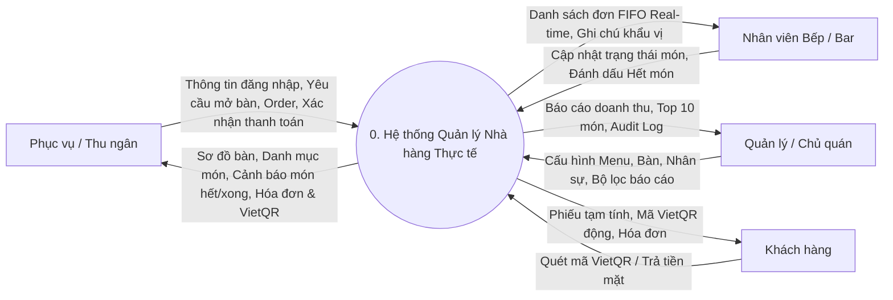

#### DFD Mức 1 (Phân rã 5 Tiến trình & 4 Kho Dữ liệu)
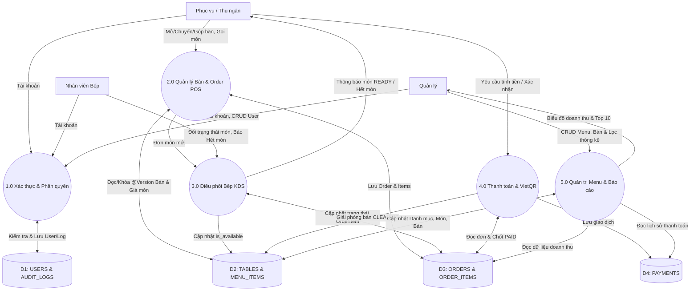

---

### 5.2 Mô hình Tương tác (Interaction Model — `Bai 06_2` P36–38)

#### Use Case Diagram Tổng quan
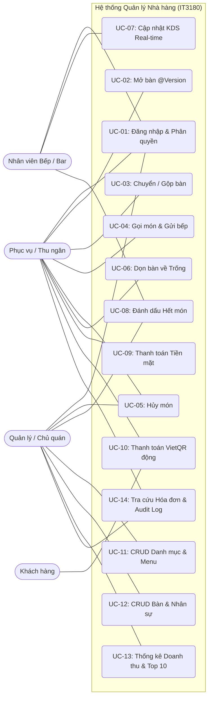

#### Sequence Diagram #1: Mở bàn (Optimistic Locking) & Gọi món POS → STOMP → KDS
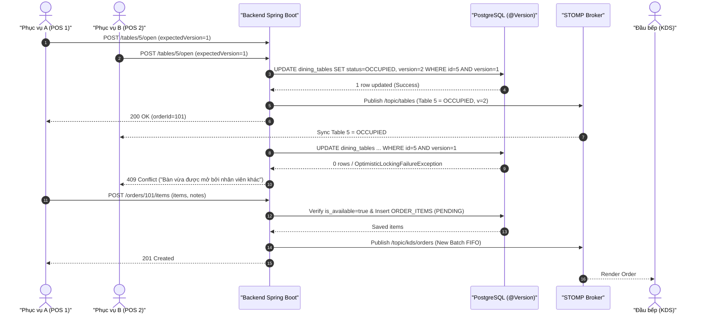

#### Sequence Diagram #2: Thanh toán VietQR Động (NAPAS EMVCo)
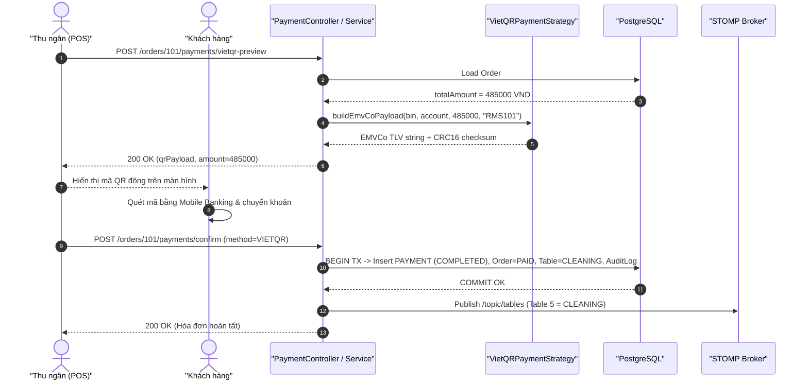

#### Sequence Diagram #3: Đánh dấu Hết món & Khóa Tức thì trên POS
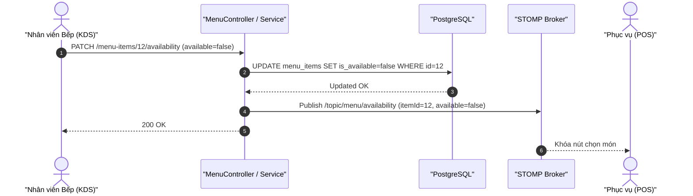

#### State Diagram / FSM #1: Vòng đời Bàn ăn (`DINING_TABLES`)
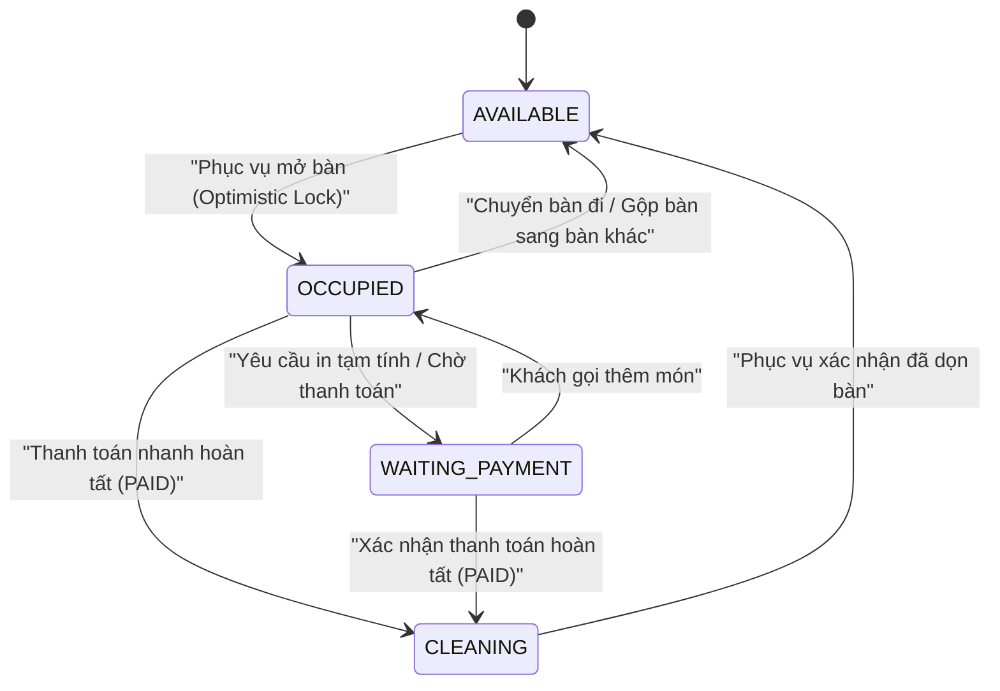

#### State Diagram / FSM #2: Vòng đời Món trong Đơn (`ORDER_ITEMS` trên KDS)
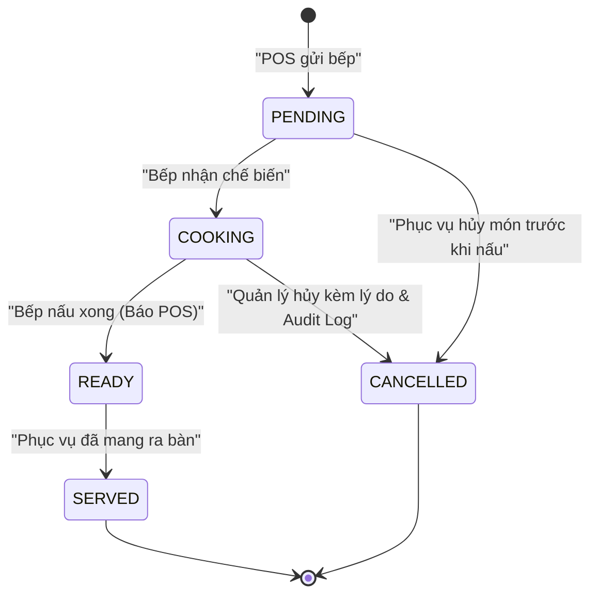

---

### 5.3 Mô hình Chức năng (Activity & Swimlane Diagram — `Bai 06_2` P40, `Bai 07_2` P23)

#### Activity Diagram: Quy trình Tính tiền & Thanh toán Hóa đơn
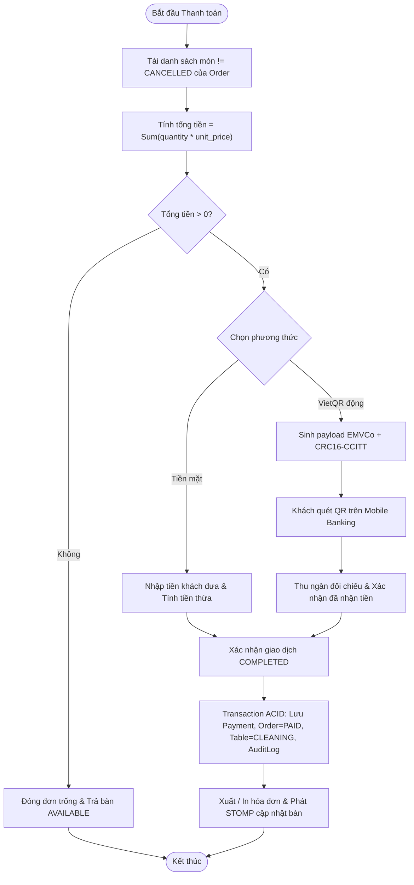

#### Swimlane Diagram: Luồng Phối hợp Xuyên suốt Sảnh (POS) – Bếp (KDS) – Thu ngân
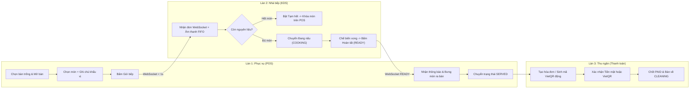

---

### 5.4 Mô hình Nội dung & Dữ liệu (Conceptual ERD — `Bai 06_2` P34)

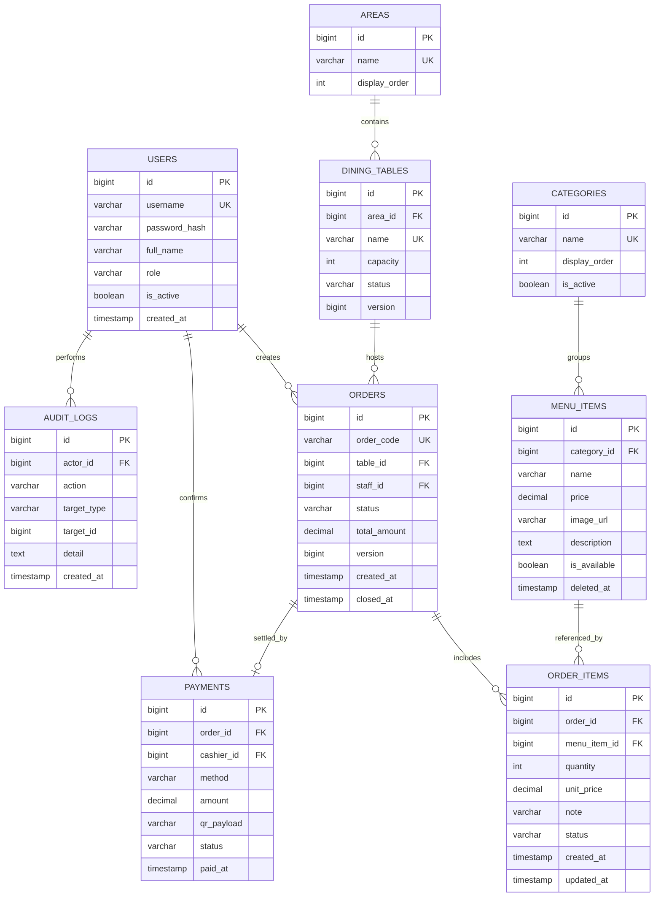

---

### 5.5 Mô hình Cấu hình & Điều hướng (`Bai 06_2` P41–43)

#### Đặc tả Cấu hình Môi trường (`Configuration Model`)
- **Máy chủ (Server):** Spring Boot 3.x (Java 17+) kết nối PostgreSQL 16 qua mạng Docker nội bộ; mở cổng HTTP/WebSocket `8080`; hỗ trợ chạy trên mạng LAN nội bộ của nhà hàng mà không phụ thuộc Internet (ngoại trừ lúc khách hàng quét QR qua 4G trên điện thoại).
- **Máy khách (Client):** React SPA phục vụ qua Vite (dev) hoặc Nginx (Docker prod); tương thích Chrome/Safari/Edge trên Tablet (POS), Màn hình lớn ≥ 24" (KDS) và Laptop (Admin).

#### Sơ đồ Điều hướng Màn hình (`Navigation Model`)
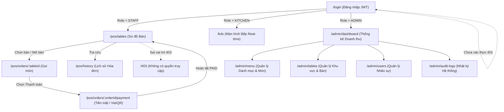

---

## 6. Ma trận Truy xuất Nguồn gốc Yêu cầu (RTM — `Bai 06_1` P48)

| Mã Yêu cầu | User Story | Use Case | Thành phần Thiết kế / Pattern dự kiến | Mã Kiểm thử dự kiến | Kỹ thuật Kiểm thử (Ch. 9) | Sprint |
| :---: | :---: | :---: | :--- | :--- | :--- | :---: |
| **FR-01** | US-04 | UC-01 | `AuthController`, `JwtService` | TC-01, TC-02 | Black-box (EP), Integration | S2 |
| **FR-02** | US-04 | UC-01 | `SecurityConfig`, `JwtAuthFilter` | TC-03, TC-04 | API Security, Role Matrix | S2 |
| **FR-03** | US-05, US-20 | UC-12, UC-14 | `AdminUserController`, `AuditLogService` | TC-05, TC-06 | Black-box, Integration | S2–S3 |
| **FR-04** | US-07, US-08 | UC-02, UC-06 | `TableController`, `TableState` | TC-07, TC-08 | State Transition Test | S2 |
| **FR-05** | US-09 | UC-02 | `TableService` (`@Version` Optimistic Lock) | TC-09, TC-10 | **White-box (CFG)** + Concurrency | S2 |
| **FR-06** | US-12 | UC-03 | `TableTransferService` | TC-11 | Integration + State Test | S3 |
| **FR-07** | US-12 | UC-03 | `OrderMergeService` (`@Transactional`) | TC-12 | Integration + Rollback Test | S3 |
| **FR-08** | US-10 | UC-04 | `MenuQueryController`, `PosMenuGrid` | TC-13 | Black-box Search/Filter | S2 |
| **FR-09** | US-10 | UC-04 | `OrderController`, `OrderService` | TC-14, TC-15 | **White-box (CFG)** + BVA | S2 |
| **FR-10** | US-11 | UC-04 | `OrderService.appendItems` | TC-16 | Integration Test | S3 |
| **FR-11** | US-11 | UC-05 | `OrderItemState` (`PENDING`/`COOKING`) | TC-17, TC-18 | **Decision Table** + Audit Test | S3 |
| **FR-12** | US-13 | UC-07 | `WebSocketConfig`, STOMP `SimpMessagingTemplate` | TC-19, TC-20 | Real-time Integration (< 1s) | S3 |
| **FR-13** | US-14 | UC-07 | `KdsController`, **State Pattern** | TC-21, TC-22 | **White-box (CFG)** + State Test | S3 |
| **FR-14** | US-14 | UC-07 | **Observer/Pub-Sub** (`/topic/pos/notifications`) | TC-23 | WebSocket Event Test | S3 |
| **FR-15** | US-15 | UC-08 | `MenuAvailabilityService` + STOMP Broadcast | TC-24, TC-25 | Integration + Concurrency | S3 |
| **FR-16** | US-17 | UC-09, UC-10 | `PaymentService`, **Strategy Pattern** | TC-26, TC-27 | **White-box (CFG)** + BVA | S3 |
| **FR-17** | US-17 | UC-10 | `VietQRPaymentStrategy`, `Crc16Util` | TC-28, TC-29 | Unit Test CRC16 + App Scan | S3 |
| **FR-18** | US-19 | UC-09, UC-10, UC-14 | `InvoiceController`, `InvoicePrintView` | TC-30 | Black-box + UI Print Check | S3 |
| **FR-19** | US-06 | UC-11 | `CategoryController`, `CategoryService` | TC-31 | Black-box CRUD + BVA | S2 |
| **FR-20** | US-06 | UC-11 | `MenuItemController` (Soft Delete) | TC-32, TC-33 | Black-box + BVA Giá ≥ 0 | S2 |
| **FR-21** | US-07 | UC-12 | `AdminTableController` | TC-34 | Decision Table (Xóa bàn bận) | S2 |
| **FR-22** | US-18 | UC-13 | `ReportController`, `ReportService` | TC-35, TC-36 | Black-box BVA ngày + Accuracy | S3 |
| **NFR-01** | US-13 | UC-07 | STOMP Broker + Async Event | TC-NFR-01 | Latency Measurement (< 1000ms) | S3–S4 |
| **NFR-02** | US-09 | UC-02 | `@Version` + PostgreSQL ACID | TC-NFR-02 | Multi-thread Stress Test | S2–S4 |
| **NFR-03** | US-03, US-10 | UC-04, UC-07 | Tailwind POS/KDS Touch UI | TC-NFR-03 | Usability Eval (5 tiêu chí) | S2 |
| **NFR-04** | US-16 | UC-07 | STOMP Heartbeat + Reconnect Hook | TC-NFR-04 | Network Disconnect/Reconnect | S3 |
| **NFR-05** | US-04, US-20 | UC-01, UC-12 | BCrypt + JWT Filter + RBAC | TC-NFR-05 | Security Matrix (`401`/`403`) | S2–S4 |
| **NFR-06** | US-01, US-22 | — | Layered Arch + Patterns + JaCoCo | TC-NFR-06 | JaCoCo ≥ 75% + CI Lint | S4 |
| **NFR-07** | US-22 | — | `docker-compose.yml` + `seed.sql` | TC-NFR-07 | Clean Machine Compose Test | S4 |
| **NFR-08** | US-17 | UC-10 | `VietQRPaymentStrategy` (EMVCo TLV) | TC-NFR-08 | CRC16 Vector + Banking App | S3 |
