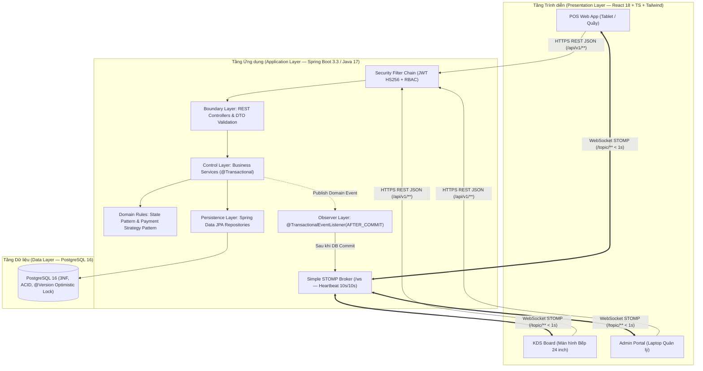
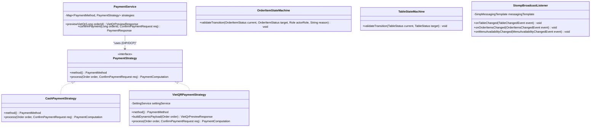
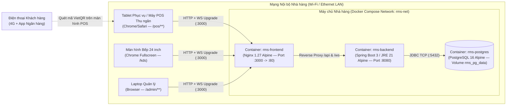

# TÀI LIỆU THIẾT KẾ PHẦN MỀM CHI TIẾT (SDD v1.0)
## HỆ THỐNG QUẢN LÝ NHÀ HÀNG THỰC TẾ (RESTAURANT MANAGEMENT SYSTEM)

> **Học phần:** Nhập môn Công nghệ Phần mềm (IT3180) — Trường CNTT&TT, Đại học Bách khoa Hà Nội  
> **Giảng viên hướng dẫn:** TS. Nguyễn Nhất Hải  
> **Nhóm thực hiện:** Nhóm 1 (`Đặng Minh Quân`, `Đào Trần Hoàng Hải`, `Vũ Tuấn Anh`, `Bùi Đại Nghĩa`)  
> **Phiên bản & Baseline:** `v1.0` — Baseline `BL-02` (`v0.2.0-design`) | **Tham chiếu:** Chương 7_1 IT3180 & Báo cáo chuẩn HUST (Chương 3 & Chương 4)

---

## 1. Thiết Kế Kiến Trúc Tổng Thể (`Bai 07_1` P40–52)

### 1.1 Mô hình Kiến trúc Phân lớp Kết hợp Hướng Sự kiện (Layered + Event-Driven)
Hệ thống áp dụng kiểu **Kiến trúc Phân lớp (Layered Architecture)** bên trong một tiến trình **Modular Monolith** (xem `ADR-0001`), kết hợp cơ chế **Publish/Subscribe qua WebSocket STOMP** (xem `ADR-0002`) để đồng bộ trạng thái thời gian thực giữa 3 phân hệ Client (`POS`, `KDS`, `Admin`).



### 1.2 Phân tích Đánh đổi Kiến trúc (Trade-off Summary)
| Quyết định kiến trúc | Phương án được chọn | Phương án thay thế bị loại | Lý do cốt lõi (Tham chiếu ADR) |
| :--- | :--- | :--- | :--- |
| Cấu trúc hệ thống | **Modular Monolith Phân lớp** | Microservices | Bảo toàn giao dịch ACID cục bộ, triển khai nhẹ bằng 1 lệnh Docker Compose (`ADR-0001`). |
| Giao tiếp Real-time | **WebSocket STOMP + Transactional Event** | HTTP Short Polling / SSE | Đạt độ trễ `< 200 ms` trên LAN, triệt tiêu tải thừa, không phát sự kiện khi DB rollback (`ADR-0002`). |
| Kiểm soát đồng thời | **Optimistic Locking (`@Version`)** | Pessimistic Lock (`FOR UPDATE`) | Không giữ khóa khi xem sơ đồ bàn, phát hiện 100% xung đột mở trùng bàn trả `409 Conflict` (`ADR-0003`). |
| Sinh mã thanh toán | **EMVCo TLV + CRC16 nội bộ (Strategy)** | Nhúng ảnh bên thứ 3 / Webhook | Không phụ thuộc Internet phía server, chuẩn NAPAS 247, dễ đổi STK khi demo (`ADR-0004`). |

---

## 2. Phân Tích Hướng Đối Tượng: Lớp Phân Tích Boundary – Control – Entity (`Bai 07_1` P32–33)

Theo chuẩn phân tích hướng đối tượng của học phần IT3180 (Chương 3 Báo cáo mẫu HUST), mỗi ca sử dụng được hiện thực hóa bởi sự cộng tác giữa 3 nhóm lớp:
- **Lớp Biên (`<<boundary>>`):** Tiếp nhận tương tác từ người dùng và hệ thống ngoài (`*Controller`, `StompBroadcastListener`, các màn hình React).
- **Lớp Điều khiển (`<<control>>`):** Điều phối luồng nghiệp vụ, giao dịch ACID, kiểm tra quyền và phát sự kiện (`*Service`, `*StateMachine`, `*PaymentStrategy`).
- **Lớp Thực thể (`<<entity>>`):** Đóng gói dữ liệu bền vững và bất biến miền (`User`, `Area`, `DiningTable`, `Category`, `MenuItem`, `Order`, `OrderItem`, `Payment`, `AuditLog`, `SystemSetting`).

| Cụm Nghiệp vụ (Use Cases) | Lớp Biên (`<<boundary>>`) | Lớp Điều khiển (`<<control>>`) | Lớp Thực thể (`<<entity>>`) |
| :--- | :--- | :--- | :--- |
| **Xác thực & Nhân sự** (`UC-01`, `UC-12`) | `AuthController`, `AdminUserController` | `AuthService`, `JwtService`, `UserService`, `AuditLogService` | `User`, `AuditLog` |
| **Sơ đồ Bàn & Chuyển/Gộp bàn** (`UC-02`, `UC-03`, `UC-06`) | `TableController`, `AreaController` | `TableService`, `TableStateMachine` | `Area`, `DiningTable` (`@Version`), `Order` |
| **Gọi món POS & Hủy món** (`UC-04`, `UC-05`) | `OrderController` | `OrderService`, `OrderItemStateMachine`, `AuditLogService` | `Order` (`@Version`), `OrderItem`, `MenuItem` |
| **Điều phối Bếp KDS & Hết món** (`UC-07`, `UC-08`) | `KdsController`, `MenuItemController`, `StompBroadcastListener` | `KdsService`, `MenuService`, `OrderItemStateMachine` | `OrderItem`, `MenuItem` |
| **Thanh toán & VietQR động** (`UC-09`, `UC-10`, `UC-14`) | `PaymentController`, `SettingController` | `PaymentService`, `CashPaymentStrategy`, `VietQRPaymentStrategy`, `Crc16Util` | `Order`, `Payment`, `DiningTable`, `SystemSetting`, `AuditLog` |
| **Quản trị Menu & Thống kê** (`UC-11`, `UC-13`) | `CategoryController`, `MenuItemController`, `ReportController` | `CategoryService`, `MenuService`, `ReportService` | `Category`, `MenuItem`, `Order`, `OrderItem`, `Payment` |

---

## 3. Thiết Kế Chi Tiết Gói, Nguyên Lý SOLID & 3 Mẫu Thiết Kế (Design Patterns)

### 3.1 Tổ chức Gói Mã nguồn (`Package Diagram`) & High Cohesion – Loose Coupling
```text
com.hust.rms
├── config/          # Cấu hình hạ tầng (SecurityConfig, WebSocketConfig, OpenApiConfig, CorsConfig)
├── security/        # Xác thực JWT stateless (JwtService, JwtAuthenticationFilter, RmsUserPrincipal)
├── common/          # Xử lý ngoại lệ tập trung, chuẩn hóa tiếng Việt, Crc16Util, EmvCoTlvBuilder
├── dto/             # Các Java record bất biến cho Request/Response (tách biệt hoàn toàn khỏi Entity)
├── domain/
│   ├── entity/      # 10 lớp JPA Entity ánh xạ bảng CSDL 3NF
│   ├── enums/       # Role, TableStatus, OrderStatus, OrderItemStatus, PaymentMethod, PaymentStatus
│   ├── state/       # State Pattern: TableStateMachine, OrderItemStateMachine
│   └── payment/     # Strategy Pattern: PaymentStrategy, CashPaymentStrategy, VietQRPaymentStrategy
├── event/           # Observer Pattern: Domain Events & StompBroadcastListener
├── repository/      # Spring Data JPA Repositories
├── service/         # Tầng dịch vụ nghiệp vụ (@Transactional)
└── controller/      # RESTful API Endpoints (/api/v1/**)
```
- **High Cohesion (`Bai 07_1` P74–76):** Mỗi lớp chỉ đảm nhận một trách nhiệm duy nhất (ví dụ `Crc16Util` chỉ tính đa thức CRC-16; `OrderItemStateMachine` chỉ xác thực quy tắc chuyển trạng thái món).
- **Loose Coupling (`Bai 07_1` P77):** Controller không bao giờ gọi trực tiếp Repository; Entity không bao giờ bị lộ trực tiếp ra JSON API (luôn chuyển qua Java `record` DTO); `OrderService` không phụ thuộc cứng vào WebSocket mà chỉ phát `ApplicationEvent`.

### 3.2 Thiết kế Chi tiết 3 Mẫu Thiết Kế GoF (`Bai 07_1` P21–25)



1. **Strategy Pattern (`com.hust.rms.domain.payment`):**
   - **Vấn đề:** Quy trình xác nhận thanh toán Tiền mặt (kiểm tra `amountReceived >= totalAmount`, tính `changeAmount`) và VietQR (sinh chuỗi EMVCo TLV + CRC16, `amountReceived = totalAmount`) khác nhau về thuật toán nhưng giống nhau về luồng chốt đơn ACID.
   - **Giải pháp:** `PaymentService` tiêm `List<PaymentStrategy>` qua constructor và tra cứu theo `PaymentMethod`. Khi tương lai bổ sung `CardPaymentStrategy` hoặc `VoucherPaymentStrategy`, không phải sửa đổi `PaymentService` (**đạt chuẩn Open-Closed Principle — OCP**).
2. **State Pattern / State Machine (`com.hust.rms.domain.state`):**
   - **Vấn đề:** Ngăn chặn các chuyển đổi trạng thái phi logic (như nhảy cóc `PENDING → SERVED`, hủy món đã `READY`, hoặc nhân viên `STAFF` tự ý hủy món đang `COOKING` không lý do).
   - **Giải pháp:** `OrderItemStateMachine` và `TableStateMachine` đóng gói ma trận chuyển trạng thái hợp lệ kèm kiểm tra vai trò `Role`, ném `InvalidStateTransitionException` (`HTTP 400`) nếu vi phạm.
3. **Observer / Publish–Subscribe Pattern (`com.hust.rms.event`):**
   - **Vấn đề:** Một thay đổi nghiệp vụ (vd: gửi đơn mới hoặc chốt hóa đơn) cần thông báo đồng thời tới KDS và sơ đồ bàn POS nhưng chỉ được phát khi CSDL đã lưu thành công.
   - **Giải pháp:** Các Service phát sự kiện bất biến (`TableChangedEvent`, `OrderItemsChangedEvent`, `MenuAvailabilityChangedEvent`) qua `ApplicationEventPublisher`; `StompBroadcastListener` lắng nghe với `@TransactionalEventListener(phase = TransactionPhase.AFTER_COMMIT)` và đẩy qua `SimpMessagingTemplate`.

### 3.3 Thiết kế Thuật toán Sinh Chuỗi VietQR EMVCo & CRC-16 (`Bai 07_1` P66–68)
Chuỗi VietQR động tuân thủ định dạng **Tag–Length–Value (TLV)** của EMVCo Merchant-Presented Mode & NAPAS 247:
- `00` (len `02`): `"01"` — Payload Format Indicator
- `01` (len `02`): `"12"` — Point of Initiation Method (`12` = QR động dùng 1 lần cho hóa đơn)
- `38` (Merchant Account Information — NAPAS):
  - Sub-tag `00`: `"A000000727"` (NAPAS AID)
  - Sub-tag `01`: Sub-TLV gồm `00` = `bankBin` (6 chữ số, vd `970415`) và `01` = `accountNumber`
  - Sub-tag `02`: `"QRIBFTTA"` (Chuyển nhanh NAPAS 247 tới số tài khoản)
- `53` (len `03`): `"704"` — Mã tiền tệ VNĐ (ISO 4217)
- `54`: Chuỗi số nguyên `amount` (vd `"485000"`)
- `58` (len `02`): `"VN"` — Country Code
- `59`: Tên đơn vị thụ hưởng không dấu tối đa 25 ký tự (vd `"NHA HANG DEMO IT3180"`)
- `60`: Thành phố (`"HA NOI"`)
- `62` (Additional Data Field Template): Sub-tag `08` = `"THANHTOAN " + orderCode`
- `63` (len `04`): Mã kiểm tra **CRC-16/CCITT-FALSE** tính trên toàn bộ chuỗi từ đầu đến hết `"6304"`, sử dụng đa thức `0x1021`, giá trị khởi tạo `0xFFFF`, xuất 4 ký tự Hex in hoa.

---

## 4. Thiết Kế Cơ Sở Dữ Liệu Mức Vật Lý & Từ Điển Dữ Liệu 6 Cột (`Bai 07_1` P69–70)

Toàn bộ lược đồ đạt chuẩn **3NF** (mọi thuộc tính không khóa phụ thuộc hàm đầy đủ và trực tiếp vào khóa chính; riêng `order_items.unit_price` là **snapshot giá bán lịch sử tại thời điểm gọi món** theo đúng nghiệp vụ kế toán để khi Admin đổi giá thực đơn không làm sai lệch hóa đơn cũ).

### 4.1 Bảng `users` (Tài khoản & Phân quyền nhân sự)
| Tên trường | Kiểu dữ liệu | Kích thước | Ràng buộc toàn vẹn | Khuôn dạng | Ghi chú |
| :--- | :--- | :---: | :--- | :--- | :--- |
| `id` | `BIGINT` | 8 bytes | `PRIMARY KEY`, Identity | Số nguyên dương | Định danh tự tăng |
| `username` | `VARCHAR` | 50 | `NOT NULL`, `UNIQUE` | `[a-zA-Z0-9_.-]+` | Tên đăng nhập |
| `password_hash` | `VARCHAR` | 255 | `NOT NULL` | Chuỗi BCrypt `$2a$10$...` | Mật khẩu đã băm |
| `full_name` | `VARCHAR` | 120 | `NOT NULL` | Unicode Tiếng Việt | Họ và tên nhân viên |
| `role` | `VARCHAR` | 20 | `NOT NULL`, `CHECK` | `ADMIN` \| `STAFF` \| `KITCHEN` | Vai trò RBAC |
| `is_active` | `BOOLEAN` | 1 byte | `NOT NULL`, `DEFAULT TRUE` | `true` / `false` | Trạng thái hoạt động |
| `created_at` | `TIMESTAMPTZ` | 8 bytes | `NOT NULL`, `DEFAULT now()` | ISO-8601 UTC | Thời điểm tạo |

### 4.2 Bảng `areas` (Khu vực / Tầng phục vụ)
| Tên trường | Kiểu dữ liệu | Kích thước | Ràng buộc toàn vẹn | Khuôn dạng | Ghi chú |
| :--- | :--- | :---: | :--- | :--- | :--- |
| `id` | `BIGINT` | 8 bytes | `PRIMARY KEY`, Identity | Số nguyên dương | Mã khu vực |
| `name` | `VARCHAR` | 100 | `NOT NULL`, `UNIQUE` | Unicode Tiếng Việt | Tên tầng/sảnh |
| `display_order` | `INTEGER` | 4 bytes | `NOT NULL`, `DEFAULT 0` | Số nguyên | Thứ tự hiển thị tab |
| `description` | `VARCHAR` | 255 | Nullable | Văn bản | Mô tả khu vực |
| `created_at` | `TIMESTAMPTZ` | 8 bytes | `NOT NULL`, `DEFAULT now()` | ISO-8601 UTC | Thời điểm tạo |

### 4.3 Bảng `dining_tables` (Bàn ăn — Kiểm soát đồng thời `@Version`)
| Tên trường | Kiểu dữ liệu | Kích thước | Ràng buộc toàn vẹn | Khuôn dạng | Ghi chú |
| :--- | :--- | :---: | :--- | :--- | :--- |
| `id` | `BIGINT` | 8 bytes | `PRIMARY KEY`, Identity | Số nguyên dương | Mã bàn |
| `area_id` | `BIGINT` | 8 bytes | `NOT NULL`, `FK -> areas(id)` | Số nguyên dương | Thuộc khu vực (`RESTRICT`) |
| `name` | `VARCHAR` | 50 | `NOT NULL`, `UNIQUE` | Vd: `T1-01`, `SV-02` | Mã/Tên bàn hiển thị |
| `capacity` | `INTEGER` | 4 bytes | `NOT NULL`, `CHECK (1..30)` | Số nguyên dương | Số ghế ngồi |
| `status` | `VARCHAR` | 25 | `NOT NULL`, `CHECK` | `AVAILABLE`, `OCCUPIED`, `WAITING_PAYMENT`, `CLEANING` | Trạng thái bàn |
| `version` | `BIGINT` | 8 bytes | `NOT NULL`, `DEFAULT 0` | Số nguyên ≥ 0 | Khóa lạc quan JPA `@Version` |
| `created_at` | `TIMESTAMPTZ` | 8 bytes | `NOT NULL`, `DEFAULT now()` | ISO-8601 UTC | Thời điểm tạo |

### 4.4 Bảng `categories` (Danh mục món ăn)
| Tên trường | Kiểu dữ liệu | Kích thước | Ràng buộc toàn vẹn | Khuôn dạng | Ghi chú |
| :--- | :--- | :---: | :--- | :--- | :--- |
| `id` | `BIGINT` | 8 bytes | `PRIMARY KEY`, Identity | Số nguyên dương | Mã danh mục |
| `name` | `VARCHAR` | 100 | `NOT NULL`, `UNIQUE` | Unicode Tiếng Việt | Vd: `Khai vị`, `Món chính` |
| `display_order` | `INTEGER` | 4 bytes | `NOT NULL`, `DEFAULT 0` | Số nguyên | Thứ tự sắp xếp |
| `is_active` | `BOOLEAN` | 1 byte | `NOT NULL`, `DEFAULT TRUE` | `true` / `false` | Ẩn/Hiện danh mục |
| `created_at` | `TIMESTAMPTZ` | 8 bytes | `NOT NULL`, `DEFAULT now()` | ISO-8601 UTC | Thời điểm tạo |

### 4.5 Bảng `menu_items` (Thực đơn món ăn)
| Tên trường | Kiểu dữ liệu | Kích thước | Ràng buộc toàn vẹn | Khuôn dạng | Ghi chú |
| :--- | :--- | :---: | :--- | :--- | :--- |
| `id` | `BIGINT` | 8 bytes | `PRIMARY KEY`, Identity | Số nguyên dương | Mã món ăn |
| `category_id` | `BIGINT` | 8 bytes | `NOT NULL`, `FK -> categories(id)` | Số nguyên dương | Thuộc danh mục |
| `name` | `VARCHAR` | 150 | `NOT NULL` | Unicode Tiếng Việt | Tên món ăn |
| `price` | `NUMERIC` | `(12, 0)` | `NOT NULL`, `CHECK (price >= 0)` | VNĐ nguyên | Đơn giá hiện hành |
| `image_url` | `VARCHAR` | 500 | Nullable | URL / Path | Ảnh minh họa món |
| `description` | `VARCHAR` | 500 | Nullable | Văn bản | Mô tả thành phần |
| `is_available` | `BOOLEAN` | 1 byte | `NOT NULL`, `DEFAULT TRUE` | `true` / `false` | Còn món / Tạm hết (`FR-15`) |
| `deleted_at` | `TIMESTAMPTZ` | 8 bytes | Nullable | ISO-8601 UTC | Xóa mềm (`NULL` = chưa xóa) |
| `created_at` | `TIMESTAMPTZ` | 8 bytes | `NOT NULL`, `DEFAULT now()` | ISO-8601 UTC | Thời điểm tạo |

### 4.6 Bảng `orders` (Đơn phục vụ tại bàn)
| Tên trường | Kiểu dữ liệu | Kích thước | Ràng buộc toàn vẹn | Khuôn dạng | Ghi chú |
| :--- | :--- | :---: | :--- | :--- | :--- |
| `id` | `BIGINT` | 8 bytes | `PRIMARY KEY`, Identity | Số nguyên dương | Định danh đơn |
| `order_code` | `VARCHAR` | 30 | `NOT NULL`, `UNIQUE` | `ORD-YYYYMMDD-XXXX` | Mã đơn hiển thị & VietQR |
| `table_id` | `BIGINT` | 8 bytes | `NOT NULL`, `FK -> dining_tables(id)` | Số nguyên dương | Bàn phục vụ |
| `staff_id` | `BIGINT` | 8 bytes | `NOT NULL`, `FK -> users(id)` | Số nguyên dương | Nhân viên mở bàn |
| `status` | `VARCHAR` | 20 | `NOT NULL`, `CHECK` | `OPEN` \| `PAID` \| `CANCELLED` | Trạng thái đơn |
| `total_amount` | `NUMERIC` | `(12, 0)` | `NOT NULL`, `CHECK (>= 0)` | VNĐ nguyên | Tổng tiền món hợp lệ |
| `version` | `BIGINT` | 8 bytes | `NOT NULL`, `DEFAULT 0` | Số nguyên ≥ 0 | Khóa lạc quan `@Version` |
| `created_at` | `TIMESTAMPTZ` | 8 bytes | `NOT NULL`, `DEFAULT now()` | ISO-8601 UTC | Giờ mở đơn |
| `closed_at` | `TIMESTAMPTZ` | 8 bytes | Nullable | ISO-8601 UTC | Giờ thanh toán/đóng đơn |

### 4.7 Bảng `order_items` (Chi tiết món gọi & hàng đợi KDS)
| Tên trường | Kiểu dữ liệu | Kích thước | Ràng buộc toàn vẹn | Khuôn dạng | Ghi chú |
| :--- | :--- | :---: | :--- | :--- | :--- |
| `id` | `BIGINT` | 8 bytes | `PRIMARY KEY`, Identity | Số nguyên dương | Mã dòng gọi món |
| `order_id` | `BIGINT` | 8 bytes | `NOT NULL`, `FK -> orders(id)` | Số nguyên dương | Thuộc đơn (`CASCADE`) |
| `menu_item_id` | `BIGINT` | 8 bytes | `NOT NULL`, `FK -> menu_items(id)` | Số nguyên dương | Món được gọi |
| `batch_no` | `INTEGER` | 4 bytes | `NOT NULL`, `CHECK (>= 1)` | Số nguyên dương | Lượt gọi món (1, 2, 3...) |
| `quantity` | `INTEGER` | 4 bytes | `NOT NULL`, `CHECK (1..99)` | Số nguyên dương | Số lượng phần |
| `unit_price` | `NUMERIC` | `(12, 0)` | `NOT NULL`, `CHECK (>= 0)` | VNĐ nguyên | Giá chốt lúc gọi |
| `note` | `VARCHAR` | 255 | Nullable | Văn bản | Ghi chú khẩu vị (ít cay...) |
| `status` | `VARCHAR` | 20 | `NOT NULL`, `CHECK` | `PENDING`, `COOKING`, `READY`, `SERVED`, `CANCELLED` | Trạng thái chế biến KDS |
| `cancel_reason` | `VARCHAR` | 255 | Nullable | Văn bản | Lý do hủy món (`FR-11`) |
| `created_at` | `TIMESTAMPTZ` | 8 bytes | `NOT NULL`, `DEFAULT now()` | ISO-8601 UTC | Mốc sắp xếp FIFO trên KDS |
| `updated_at` | `TIMESTAMPTZ` | 8 bytes | `NOT NULL`, `DEFAULT now()` | ISO-8601 UTC | Lần đổi trạng thái cuối |

### 4.8 Bảng `payments` (Giao dịch thanh toán hóa đơn)
| Tên trường | Kiểu dữ liệu | Kích thước | Ràng buộc toàn vẹn | Khuôn dạng | Ghi chú |
| :--- | :--- | :---: | :--- | :--- | :--- |
| `id` | `BIGINT` | 8 bytes | `PRIMARY KEY`, Identity | Số nguyên dương | Mã thanh toán |
| `order_id` | `BIGINT` | 8 bytes | `NOT NULL`, `UNIQUE`, `FK` | Số nguyên dương | Liên kết 1–1 với `orders` |
| `cashier_id` | `BIGINT` | 8 bytes | `NOT NULL`, `FK -> users(id)` | Số nguyên dương | Thu ngân xác nhận |
| `method` | `VARCHAR` | 20 | `NOT NULL`, `CHECK` | `CASH` \| `VIETQR` | Phương thức thanh toán |
| `amount` | `NUMERIC` | `(12, 0)` | `NOT NULL`, `CHECK (> 0)` | VNĐ nguyên | Số tiền hóa đơn |
| `amount_received` | `NUMERIC` | `(12, 0)` | `NOT NULL`, `CHECK (>= amount)` | VNĐ nguyên | Tiền khách đưa |
| `change_amount` | `NUMERIC` | `(12, 0)` | `NOT NULL`, `CHECK (>= 0)` | VNĐ nguyên | Tiền thừa trả khách |
| `qr_payload` | `TEXT` | Không giới hạn | Nullable | EMVCo TLV + CRC16 | Lưu chuỗi VietQR đã sinh |
| `status` | `VARCHAR` | 20 | `NOT NULL`, `CHECK` | `COMPLETED` \| `VOIDED` | Trạng thái giao dịch |
| `paid_at` | `TIMESTAMPTZ` | 8 bytes | `NOT NULL`, `DEFAULT now()` | ISO-8601 UTC | Thời điểm thanh toán |

### 4.9 Bảng `audit_logs` & `system_settings`
| Bảng | Trường chính | Kiểu & Ràng buộc | Mục đích thiết kế |
| :--- | :--- | :--- | :--- |
| **`audit_logs`** | `id` (PK), `actor_id` (FK), `action` (`VARCHAR(80)`), `target_type` (`VARCHAR(50)`), `target_id` (`BIGINT`), `detail` (`TEXT`), `created_at` (`TIMESTAMPTZ`) | `NOT NULL` trên `action`, `target_type`, `created_at` | Lưu vết chống thất thoát khi hủy món `COOKING`, đổi giá món, khóa tài khoản, xác nhận thanh toán (`FR-03`, `US-20`). |
| **`system_settings`** | `setting_key` (`VARCHAR(100)` PK), `setting_value` (`TEXT NOT NULL`), `updated_at` (`TIMESTAMPTZ`) | Khóa chính tự nhiên `setting_key` | Lưu `RESTAURANT_NAME`, `VIETQR_BANK_BIN`, `VIETQR_ACCOUNT_NUMBER`, `VIETQR_ACCOUNT_NAME` để cấu hình linh hoạt. |

---

## 5. Hợp Đồng Giao Tiếp API & STOMP Khóa Cứng (Frozen Interface Contract)

> **Quy tắc bắt buộc cho Subagent Backend & Frontend:** Giữ nguyên chính xác đường dẫn, phương thức HTTP, tên trường JSON (`camelCase`) và chuỗi hằng Enum dưới đây.

### 5.1 Chuẩn Phản Hồi Lỗi Chung (`ErrorResponse`)
```json
{
  "timestamp": "2026-11-26T09:30:00Z",
  "status": 409,
  "error": "CONFLICT",
  "code": "TABLE_VERSION_CONFLICT",
  "message": "Bàn vừa được nhân viên khác mở. Đã làm mới sơ đồ bàn.",
  "path": "/api/v1/tables/1/open"
}
```

### 5.2 Danh mục RESTful API Endpoints (`/api/v1`)

| Nhóm | Method & Endpoint | Quyền (`Role`) | Request Body / Query chính | Response Body (`200`/`201`) | Mã lỗi nghiệp vụ |
| :--- | :--- | :--- | :--- | :--- | :--- |
| **Auth** | `POST /api/v1/auth/login` | Public | `{ username, password }` | `{ accessToken, tokenType, expiresInMs, user: { id, username, fullName, role } }` | `401` sai thông tin / bị khóa |
| **Auth** | `GET /api/v1/auth/me` | Authenticated | Header `Authorization: Bearer <jwt>` | `{ id, username, fullName, role, isActive }` | `401` thiếu/hết hạn token |
| **Areas** | `GET /api/v1/areas` | `STAFF`, `KITCHEN`, `ADMIN` | — | `AreaDto[]`: `[{ id, name, displayOrder, description }]` | — |
| **Areas** | `POST /api/v1/areas`<br>`PUT /api/v1/areas/{id}`<br>`DELETE /api/v1/areas/{id}` | `ADMIN` | `{ name, displayOrder, description }` | `AreaDto` / `204 No Content` | `409` trùng tên hoặc còn bàn |
| **Tables** | `GET /api/v1/tables` | `STAFF`, `KITCHEN`, `ADMIN` | `?areaId=` *(optional)* | `DiningTableDto[]`: `[{ id, areaId, areaName, name, capacity, status, version, activeOrderId, activeOrderCode, activeOrderTotal }]` | — |
| **Tables** | `POST /api/v1/tables`<br>`PUT /api/v1/tables/{id}`<br>`DELETE /api/v1/tables/{id}` | `ADMIN` | `{ areaId, name, capacity }` | `DiningTableDto` / `204 No Content` | `409` nếu xóa bàn đang `OCCUPIED` / `WAITING_PAYMENT` (`FR-21`) |
| **Tables** | `POST /api/v1/tables/{id}/open` | `STAFF`, `ADMIN` | `{ expectedVersion: number }` | `{ table: DiningTableDto, order: OrderDto }` | `409` lệch `version` hoặc bàn không `AVAILABLE` (`FR-05`) |
| **Tables** | `POST /api/v1/tables/{id}/clean` | `STAFF`, `ADMIN` | — | `DiningTableDto` (`status = "AVAILABLE"`) | `400` nếu bàn không ở `CLEANING` |
| **Tables** | `POST /api/v1/tables/{id}/transfer` | `STAFF`, `ADMIN` | `{ targetTableId: number }` | `OrderDto` (đã chuyển sang bàn đích) | `400`/`409` nếu bàn đích không `AVAILABLE` (`FR-06`) |
| **Tables** | `POST /api/v1/tables/merge` | `STAFF`, `ADMIN` | `{ sourceTableIds: number[], targetTableId: number }` | `OrderDto` (đã gộp toàn bộ món về đơn đích, giải phóng bàn nguồn) | `400`/`409` nếu bàn không hợp lệ (`FR-07`) |
| **Menu** | `GET /api/v1/categories` | `STAFF`, `KITCHEN`, `ADMIN` | `?activeOnly=false` | `CategoryDto[]`: `[{ id, name, displayOrder, isActive }]` | — |
| **Menu** | `POST /api/v1/categories`<br>`PUT /api/v1/categories/{id}`<br>`DELETE /api/v1/categories/{id}` | `ADMIN` | `{ name, displayOrder, isActive }` | `CategoryDto` / `204` | `409` trùng tên |
| **Menu** | `GET /api/v1/menu-items` | `STAFF`, `KITCHEN`, `ADMIN` | `?categoryId=&search=&availableOnly=` | `MenuItemDto[]`: `[{ id, categoryId, categoryName, name, price, imageUrl, description, isAvailable }]` | — |
| **Menu** | `POST /api/v1/menu-items`<br>`PUT /api/v1/menu-items/{id}`<br>`DELETE /api/v1/menu-items/{id}` | `ADMIN` | `{ categoryId, name, price, imageUrl, description, isAvailable }` | `MenuItemDto` / `204` *(soft-delete)* | `400` nếu `price < 0` (`FR-20`) |
| **Menu** | `PATCH /api/v1/menu-items/{id}/availability` | `KITCHEN`, `ADMIN` | `{ isAvailable: boolean }` | `MenuItemDto` | `404` không tìm thấy (`FR-15`) |
| **Orders** | `GET /api/v1/tables/{tableId}/active-order` | `STAFF`, `ADMIN` | — | `OrderDto` (kèm `items[]` & `payment`) | `404` nếu bàn chưa có đơn `OPEN` |
| **Orders** | `GET /api/v1/orders` | `STAFF`, `ADMIN` | `?status=&from=YYYY-MM-DD&to=YYYY-MM-DD&method=` | `OrderSummaryDto[]`: `[{ id, orderCode, tableName, staffName, status, totalAmount, paymentMethod, createdAt, closedAt }]` | `400` nếu `from > to` (`FR-18`) |
| **Orders** | `GET /api/v1/orders/{id}` | `STAFF`, `KITCHEN`, `ADMIN` | — | `OrderDto`: `{ id, orderCode, tableId, tableName, areaName, staffId, staffName, status, totalAmount, version, createdAt, closedAt, items: OrderItemDto[], payment: PaymentDto \| null }` | `404` |
| **Orders** | `POST /api/v1/orders/{id}/items` | `STAFF`, `ADMIN` | `{ items: [{ menuItemId, quantity, note }] }` | `201 Created` → `OrderDto` | `422` nếu có món `isAvailable=false` (`FR-09`, `FR-10`) |
| **Orders** | `POST /api/v1/orders/{id}/items/{itemId}/cancel` | `STAFF`, `KITCHEN`, `ADMIN` | `{ reason?: string }` | `OrderDto` | `403` nếu `STAFF` hủy món `COOKING`; `400` nếu thiếu lý do hoặc đã `READY`/`SERVED` (`FR-11`) |
| **Orders** | `POST /api/v1/orders/{id}/request-payment` | `STAFF`, `ADMIN` | — | `OrderDto` (chuyển bàn sang `WAITING_PAYMENT`) | `400` |
| **KDS** | `GET /api/v1/kds/items` | `KITCHEN`, `STAFF`, `ADMIN` | — | `KdsItemDto[]`: `[{ id, orderId, orderCode, tableId, tableName, areaName, menuItemId, menuItemName, batchNo, quantity, note, status, createdAt, updatedAt }]` *(FIFO `createdAt ASC`)* | — |
| **KDS** | `PATCH /api/v1/kds/items/{itemId}/status` | `KITCHEN`, `STAFF`, `ADMIN` | `{ status: "COOKING" \| "READY" \| "SERVED" }` | `KdsItemDto` | `400` nếu vi phạm State Machine (`FR-13`) |
| **Payment** | `POST /api/v1/orders/{id}/payments/vietqr-preview` | `STAFF`, `ADMIN` | — | `VietQrPreviewDto`: `{ orderId, orderCode, amount, bankBin, accountNumber, accountName, addInfo, qrPayload }` | `400` nếu đơn trống `totalAmount == 0` (`FR-17`) |
| **Payment** | `POST /api/v1/orders/{id}/payments/confirm` | `STAFF`, `ADMIN` | `{ method: "CASH" \| "VIETQR", amountReceived?: number }` | `PaymentDto`: `{ id, orderId, orderCode, method, amount, amountReceived, changeAmount, qrPayload, status, paidAt, cashierName }` | `400` tiền mặt `< amount`; `409` đơn đã `PAID` (`FR-16`) |
| **Admin** | `GET /api/v1/admin/users`<br>`POST /api/v1/admin/users`<br>`PUT /api/v1/admin/users/{id}`<br>`PATCH /api/v1/admin/users/{id}/status` | `ADMIN` | `{ username, password?, fullName, role, isActive }` | `UserDto` (`{ id, username, fullName, role, isActive, createdAt }`) | `400` nếu tự khóa tài khoản `ADMIN` cuối cùng (`FR-03`) |
| **Admin** | `GET /api/v1/admin/settings`<br>`PUT /api/v1/admin/settings` | `GET`: Auth<br>`PUT`: `ADMIN` | `{ restaurantName, vietqrBankBin, vietqrAccountNumber, vietqrAccountName }` | `SystemSettingsDto` | `400` nếu BIN không đủ 6 chữ số |
| **Admin** | `GET /api/v1/admin/reports/revenue` | `ADMIN` | `?from=YYYY-MM-DD&to=YYYY-MM-DD` | `RevenueReportDto`: `{ from, to, totalRevenue, paidOrderCount, cashRevenue, vietqrRevenue, dailySeries: [{ date, revenue, orderCount }], topItems: [{ menuItemId, menuItemName, categoryName, totalQuantity, totalRevenue }] }` | `400` nếu `from > to` (`FR-22`) |
| **Admin** | `GET /api/v1/admin/audit-logs` | `ADMIN` | `?limit=100` | `AuditLogDto[]`: `[{ id, actorUsername, actorFullName, action, targetType, targetId, detail, createdAt }]` | — |

### 5.3 Hợp đồng Kênh WebSocket STOMP (`/ws`)
- **Endpoint kết nối:** `ws://<host>/ws` (STOMP over WebSocket thuần; truyền `connectHeaders: { Authorization: "Bearer <accessToken>" }`).
- **Heartbeat:** `10000 ms` hai chiều.
- **4 Topic chuẩn:**
  1. `/topic/tables` → `{ "eventType": "TABLE_UPDATED", "tableId": 5, "status": "OCCUPIED", "timestamp": "..." }`
  2. `/topic/kds/orders` → `{ "eventType": "ORDER_ITEMS_ADDED" | "ITEM_STATUS_CHANGED" | "ITEM_CANCELLED", "orderId": 101, "orderCode": "ORD-...", "tableName": "T1-01", "items": [...], "timestamp": "..." }`
  3. `/topic/pos/notifications` → `{ "eventType": "ITEM_READY", "orderId": 101, "orderCode": "ORD-...", "tableId": 1, "tableName": "T1-01", "itemId": 55, "menuItemName": "Phở Bò Tái Lăn", "quantity": 2, "message": "Bàn T1-01: 2x Phở Bò Tái Lăn đã nấu xong!", "timestamp": "..." }`
  4. `/topic/menu/availability` → `{ "eventType": "MENU_AVAILABILITY_CHANGED", "menuItemId": 12, "menuItemName": "Bún Chả Hà Nội", "isAvailable": false, "timestamp": "..." }`

---

## 6. Sơ Đồ Triển Khai Vật Lý (Deployment Diagram — `Bai 07_1` P38, P61)



---

## 7. Truy Xuất Đầy Đủ 22 Yêu Cầu Chức Năng Tới Thiết Kế (`FR-01` → `FR-22`)

| Mã FR | Lớp Controller & Endpoint | Lớp Service / Pattern Xử lý | Bảng CSDL Tác động |
| :---: | :--- | :--- | :--- |
| `FR-01` | `AuthController.login` | `AuthService`, `JwtService` | `users` |
| `FR-02` | `SecurityConfig`, `JwtAuthenticationFilter` | `@PreAuthorize` RBAC | `users` |
| `FR-03` | `AdminUserController`, `ReportController.auditLogs` | `UserService`, `AuditLogService` | `users`, `audit_logs` |
| `FR-04` | `TableController.listTables` | `TableService`, `TableStateMachine` | `areas`, `dining_tables`, `orders` |
| `FR-05` | `TableController.openTable` | `TableService` (`@Version` Optimistic Lock) | `dining_tables`, `orders` |
| `FR-06` | `TableController.transferTable` | `TableService.transferTable` (`@Transactional`) | `dining_tables`, `orders`, `audit_logs` |
| `FR-07` | `TableController.mergeTables` | `TableService.mergeTables` (`@Transactional`) | `dining_tables`, `orders`, `order_items`, `audit_logs` |
| `FR-08` | `MenuItemController.listMenuItems` | `MenuService` (tìm kiếm bỏ dấu Tiếng Việt) | `categories`, `menu_items` |
| `FR-09` | `OrderController.addItems` | `OrderService` | `orders`, `order_items`, `menu_items` |
| `FR-10` | `OrderController.addItems` (`batch_no + 1`) | `OrderService` | `orders`, `order_items` |
| `FR-11` | `OrderController.cancelItem` | `OrderService`, `OrderItemStateMachine`, `AuditLogService` | `order_items`, `orders`, `audit_logs` |
| `FR-12` | `StompBroadcastListener.onOrderItemsChanged` | **Observer Pattern** (`/topic/kds/orders`) | `order_items` |
| `FR-13` | `KdsController.updateItemStatus` | `KdsService`, **State Pattern** (`OrderItemStateMachine`) | `order_items` |
| `FR-14` | `StompBroadcastListener.onOrderItemsChanged` | **Observer Pattern** (`/topic/pos/notifications`) | `order_items` |
| `FR-15` | `MenuItemController.toggleAvailability` | `MenuService`, **Observer Pattern** (`/topic/menu/availability`) | `menu_items`, `audit_logs` |
| `FR-16` | `PaymentController.confirmPayment` | `PaymentService`, **Strategy Pattern** (`CashPaymentStrategy`) | `payments`, `orders`, `dining_tables`, `audit_logs` |
| `FR-17` | `PaymentController.previewVietQr` & `confirmPayment` | `VietQRPaymentStrategy`, `Crc16Util`, `EmvCoTlvBuilder` | `payments`, `orders`, `dining_tables`, `system_settings` |
| `FR-18` | `OrderController.listOrders` & `getOrder` | `OrderService` + UI `PrintableReceipt` (`@media print`) | `orders`, `order_items`, `payments` |
| `FR-19` | `CategoryController` (CRUD) | `CategoryService` | `categories` |
| `FR-20` | `MenuItemController` (CRUD + Soft Delete) | `MenuService`, `AuditLogService` | `menu_items`, `audit_logs` |
| `FR-21` | `AreaController`, `TableController` (CRUD) | `TableService` (chặn xóa bàn đang bận) | `areas`, `dining_tables` |
| `FR-22` | `ReportController.getRevenueReport` | `ReportService` | `orders`, `order_items`, `payments`, `menu_items` |
