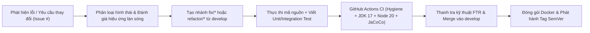

# KẾ HOẠCH BẢO TRÌ & BIỂU QUẢN LÝ BẢO TRÌ PHẦN MỀM (MAINTENANCE PLAN & LOG)

> **Dự án:** Hệ thống Quản lý Nhà hàng Thực tế (Restaurant Management System — RMS)  
> **Học phần:** IT3180 — Nhập môn Công nghệ Phần mềm (Chương 8 & Chương 9: Tái cấu trúc, Đảm bảo chất lượng & Bảo trì)  
> **Giảng viên hướng dẫn:** TS. Nguyễn Nhất Hải  
> **Phiên bản Baseline:** `BL-05 (v1.0.0)` | **Chủ trì:** Bùi Đại Nghĩa *(QA Lead)* & Vũ Tuấn Anh *(Configuration Manager)*

---

## 1. Chiến lược Bảo trì theo 4 Hình thái Chuẩn CNPM (`Bai 09` trang 41–45)

Hệ thống được vận hành tại môi trường nhà hàng phục vụ tại chỗ (Dine-in, mạng LAN nội bộ, máy tính bảng thu ngân và màn hình tivi bếp). Kế hoạch bảo trì sau bàn giao được phân loại rõ theo 4 hình thái chuẩn IEEE/ISO:

| Hình thái bảo trì | Tỷ trọng dự kiến | Phạm vi áp dụng cụ thể trên Hệ thống Quản lý Nhà hàng | Cơ chế kiểm soát rủi ro & hồi quy |
| :--- | :---: | :--- | :--- |
| **1. Bảo trì Tu chỉnh** *(Corrective Maintenance)* | ~20% | Sửa các lỗi logic hoặc hiển thị phát sinh trong ca bán hàng (ví dụ: lệch tổng tiền khi hủy món, rớt kết nối STOMP không tự đồng bộ lại, sai nhãn trạng thái bàn). | Bắt buộc viết bổ sung ca kiểm thử tái hiện lỗi (*Regression Test*) trong JUnit 5 / Vitest trước khi đóng PR `fix/*`. |
| **2. Bảo trì Thích nghi** *(Adaptive Maintenance)* | ~25% | Thích ứng khi thay đổi môi trường hạ tầng: nâng cấp Docker Engine, đổi cổng host do xung đột dịch vụ (`POSTGRES_PORT`, `SERVER_PORT`), cập nhật chuẩn biểu mẫu mã QR NAPAS 247 hoặc thay đổi trình duyệt Chrome trên máy POS. | Tách biệt hoàn toàn tham số hạ tầng qua `.env` và bảng `system_settings`; dùng Multi-stage Docker Alpine đa kiến trúc (`linux/amd64` & `linux/arm64`). |
| **3. Bảo trì Hoàn thiện / Cải tiến** *(Perfective Maintenance)* | ~35% | Cải tiến hiệu năng truy vấn báo cáo doanh thu, tối ưu thao tác gọi món $\le 3$ chạm trên màn hình cảm ứng, hoặc mở rộng các tính năng `Could-have` (mã giảm giá `VoucherDiscountStrategy`, tách hóa đơn lẻ). | Áp dụng **Strategy Pattern** (`PaymentStrategy`) và kiến trúc phân tầng để mở rộng không sửa đổi mã lõi (*Open-Closed Principle*). |
| **4. Bảo trì Phòng ngừa** *(Preventive Maintenance / Code Restructuring)* | ~20% | Chủ động tái cấu trúc mã nguồn (*Refactoring* — `Bai 08` trang 33–45) nhằm tăng độ kết dính (*Cohesion*), giảm ghép nối (*Coupling*) và ngăn suy thoái kiến trúc trước khi mở rộng. | Mọi PR `refactor/*` tuyệt đối không làm thay đổi hành vi bên ngoài và phải vượt qua cổng `jacoco:check` (`LINE >= 80%`, `BRANCH >= 75%`). |

---

## 2. Quy trình Xử lý Yêu cầu Bảo trì gắn với Quản lý Cấu hình (SCM)

---

## 3. Bằng chứng Tái cấu trúc Mã nguồn Chương 8 (*Code Restructuring — Zero Behavior Change*)

Nhóm đã thực hiện **02 Pull Request `refactor:` độc lập** liên kết trực tiếp tới [Issue #7](https://github.com/dangminhquandk/restaurant-management-system/issues/7), tuân thủ nghiêm ngặt quy tắc Chương 8: làm sạch cấu trúc bên trong mà không thay đổi bất kỳ hợp đồng API hay hành vi nghiệp vụ bên ngoài nào.

| Mã PR | Nhánh tái cấu trúc | Mùi mã nguồn (*Code Smell*) trước khi sửa | Kỹ thuật tái cấu trúc áp dụng | Bằng chứng kiểm chứng hồi quy |
| :---: | :--- | :--- | :--- | :--- |
| **[PR #8](https://github.com/dangminhquandk/restaurant-management-system/pull/8)** | `refactor/ch08-extract-order-code-generator` | `TableService` ôm đồm cả điều phối máy trạng thái bàn lẫn định dạng ngày theo múi giờ `Asia/Ho_Chi_Minh`, bộ đếm `AtomicInteger` và vòng lặp kiểm tra trùng mã `ORD-yyyyMMdd-XXXX` (*Low Cohesion*). | **Extract Class** thành `@Component` [OrderCodeGenerator.java](file:///Users/quandkh/Documents/Learning%20Hub/restaurant-management-system/backend/src/main/java/com/hust/rms/service/OrderCodeGenerator.java) hỗ trợ tiêm `Clock` cố định để kiểm thử đơn vị độc lập. | `51/51` JUnit 5 tests `PASS` (thêm mới [OrderCodeGeneratorTest.java](file:///Users/quandkh/Documents/Learning%20Hub/restaurant-management-system/backend/src/test/java/com/hust/rms/service/OrderCodeGeneratorTest.java)), CI xanh `3/3` jobs, commit `3bc53b8`. |
| **[PR #9](https://github.com/dangminhquandk/restaurant-management-system/pull/9)** | `refactor/ch08-extract-pos-cart-hook` | [OrderPadPage.tsx](file:///Users/quandkh/Documents/Learning%20Hub/restaurant-management-system/frontend/src/features/pos/OrderPadPage.tsx) dài 943 dòng, trộn lẫn đồng bộ STOMP thời gian thực với các phép biến đổi mảng bất biến của giỏ gọi món tạm (*Large Component*). | **Extract Custom Hook** sang [usePosCart.ts](file:///Users/quandkh/Documents/Learning%20Hub/restaurant-management-system/frontend/src/features/pos/usePosCart.ts) đóng gói toàn bộ trạng thái giỏ, giới hạn 99 phần/dòng, ghi chú khẩu vị và tổng tạm tính. | `14/14` Vitest tests `PASS` (thêm mới [usePosCart.test.ts](file:///Users/quandkh/Documents/Learning%20Hub/restaurant-management-system/frontend/src/features/pos/__tests__/usePosCart.test.ts)), `eslint` 0 lỗi, `vite build` thành công, commit `7d76d04`. |

---

## 4. Biểu Quản lý Bảo trì & Sửa lỗi Thực tế (`Bai 09` trang 48 — 6 Cột Bắt buộc)

Bảng dưới đây ghi nhận đầy đủ các đợt bảo trì tu chỉnh, thích nghi, hoàn thiện và phòng ngừa đã thực thi xuyên suốt Sprint 2 – Sprint 4 của dự án:

| Ngày tháng / Giờ | Nguyên nhân (Phân loại bảo trì) | Tóm tắt cách khắc phục | Chi tiết khắc phục & Kiểm tra hiệu ứng làn sóng (*Ripple / Regression Check*) | Người làm bảo trì | Số công (giờ) |
| :--- | :--- | :--- | :--- | :---: | :---: |
| `2026-11-26 09:35` | **Thích nghi (Adaptive):** Cổng mặc định `5432` và `8080` trên máy chủ triển khai đã bị chiếm bởi cụm container dữ liệu có sẵn (`de_postgres`, `de_pgadmin`). | Tham số hóa toàn bộ cổng xuất ra host qua `.env` (`POSTGRES_PORT`, `SERVER_PORT`, `FRONTEND_PORT`) và cô lập project namespace `name: rms`. | Cập nhật [docker-compose.yml](file:///Users/quandkh/Documents/Learning%20Hub/restaurant-management-system/docker-compose.yml) và [application.yml](file:///Users/quandkh/Documents/Learning%20Hub/restaurant-management-system/backend/src/main/resources/application.yml). Trong mạng nội bộ `rms-net`, Nginx vẫn proxy tới `backend:8080` và Backend nối tới `postgres:5432`, không ảnh hưởng tới các container ngoài dự án. | Vũ Tuấn Anh | `1.5h` |
| `2026-11-26 10:15` | **Tu chỉnh (Corrective):** Nguy cơ trình biên dịch sử dụng API riêng của JDK 21 làm vỡ pipeline GitHub Actions CI chạy trên `temurin-17`. | Khóa cứng cờ `<maven.compiler.release>17</maven.compiler.release>` trong `maven-compiler-plugin`. | Sửa [pom.xml](file:///Users/quandkh/Documents/Learning%20Hub/restaurant-management-system/backend/pom.xml) để trình biên dịch `javac` kiểm tra nghiêm ngặt bảng ký hiệu chuẩn Java SE 17 ngay từ dưới máy lập trình viên; kiểm tra hồi quy CI trên PR `#4` và `#6` xanh 100%. | Vũ Tuấn Anh & Đặng Minh Quân | `1.0h` |
| `2026-11-26 10:45` | **Tu chỉnh (Corrective):** Rủi ro phát thông báo STOMP xuống màn hình KDS trước khi giao dịch CSDL commit xong (gây đọc dữ liệu chưa ghi hoặc ma đơn khi rollback). | Chuyển bộ phát sự kiện sang `@TransactionalEventListener(phase = TransactionPhase.AFTER_COMMIT)`. | Tách các Domain Event (`TableChangedEvent`, `OrderItemsChangedEvent`, `MenuAvailabilityChangedEvent`) và chỉ đẩy khung tin STOMP tại `StompBroadcastListener` sau khi PostgreSQL xác nhận commit thành công. Kiểm chứng bằng `WebSocketStompLatencyIntegrationTest` (`< 1000ms`). | Đặng Minh Quân | `2.0h` |
| `2026-11-26 11:15` | **Phòng ngừa (Preventive — PR #8):** `TableService` chứa logic sinh mã hóa đơn và xử lý múi giờ làm giảm độ kết dính đơn chức năng. | Tách lớp `OrderCodeGenerator` độc lập và tiêm qua Constructor Injection vào `TableService`. | Cập nhật `openTable()` và `mergeTables()` trong [TableService.java](file:///Users/quandkh/Documents/Learning%20Hub/restaurant-management-system/backend/src/main/java/com/hust/rms/service/TableService.java). Chạy lại toàn bộ `51` bài kiểm thử tích hợp & đồng thời (`TableConcurrencyIntegrationTest`) bảo đảm không phát sinh hiệu ứng làn sóng. | Đặng Minh Quân & Bùi Đại Nghĩa | `1.5h` |
| `2026-11-26 11:18` | **Phòng ngừa (Preventive — PR #9):** Logic giỏ gọi món tạm nằm lẫn trong `OrderPadPage.tsx` gây khó kiểm thử đơn vị độc lập. | Tách custom hook `usePosCart.ts` và viết bộ kiểm thử `usePosCart.test.ts`. | Thay thế state nội bộ trong [OrderPadPage.tsx](file:///Users/quandkh/Documents/Learning%20Hub/restaurant-management-system/frontend/src/features/pos/OrderPadPage.tsx) bằng `usePosCart()`. Kiểm tra hồi quy trên `OrderPadPage.test.tsx` và toàn bộ 8 tệp kiểm thử Vitest (`14/14 PASS`), giữ nguyên cơ chế bảo toàn giỏ khi rớt mạng LAN (`NFR-04`). | Đào Trần Hoàng Hải | `1.5h` |
| `2026-11-26 11:24` | **Thích nghi (Adaptive):** Image cơ sở `eclipse-temurin:17-jdk-alpine` không có manifest cho kiến trúc Apple Silicon (`linux/arm64`). | Nâng cấp base image đóng gói lên `eclipse-temurin:21-jdk-alpine` & `21-jre-alpine` đa kiến trúc kết hợp cờ biên dịch `--release 17`. | Cập nhật [backend/Dockerfile](file:///Users/quandkh/Documents/Learning%20Hub/restaurant-management-system/backend/Dockerfile) giữ nguyên bytecode chuẩn Java 17, chạy dưới tài khoản phi đặc quyền `rms:rms` và tích hợp `HEALTHCHECK` tự động qua `/actuator/health`. Kiểm chứng build chạy đa nền tảng `amd64`/`arm64`. | Vũ Tuấn Anh | `1.0h` |
| `2026-11-26 11:26` | **Hoàn thiện (Perfective — Issue #10):** Cần khóa cứng ngưỡng chất lượng mã nguồn tầng nghiệp vụ theo `NFR-06` tránh tụt độ phủ khi bảo trì về sau. | Cấu hình `jacoco:check` bắt buộc `LINE >= 80%`, `BRANCH >= 75%` và bổ sung 4 bộ kiểm thử phủ nhánh chuyên sâu. | Cập nhật [pom.xml](file:///Users/quandkh/Documents/Learning%20Hub/restaurant-management-system/backend/pom.xml); nâng độ phủ thực tế tầng `com.hust.rms.service` lên **97.7% Line / 90.8% Branch** và `domain.state`, `domain.payment` đạt **100.0% Line / 100.0% Branch**. | Bùi Đại Nghĩa | `3.0h` |
| `2026-11-26 14:30` | **Tu chỉnh (Corrective — Phát hiện qua Browser E2E trên PostgreSQL 16):** Truy vấn `GET /api/v1/orders?from=...&to=...` (màn hình `/pos/history`) ném `PSQLException: could not determine data type of parameter $3` khi tham số `status` / `method` truyền `null` trên trình điều khiển JDBC PostgreSQL (lỗi bị che khuất trên H2). | Loại bỏ biểu thức `(? IS NULL)` không tường minh kiểu trong JPQL `OrderRepository` bằng truy vấn khoảng thời gian có cận xác định `findOrderSummariesInWindow` (tận dụng trực tiếp B-tree index `idx_orders_created_at`) và lọc `status`/`method` tường minh tại `OrderService`. | Sửa [OrderRepository.java](file:///Users/quandkh/Documents/Learning%20Hub/restaurant-management-system/backend/src/main/java/com/hust/rms/repository/OrderRepository.java) và [OrderService.java](file:///Users/quandkh/Documents/Learning%20Hub/restaurant-management-system/backend/src/main/java/com/hust/rms/service/OrderService.java); chạy lại `mvn verify` + dựng lại container `rms-backend` kiểm chứng trực tiếp trên Chrome `/pos/history` trả `200 OK` (`0` lỗi 5xx). | Nguyễn Đăng Khôi & Bùi Đại Nghĩa | `1.0h` |

> **Tổng hao phí bảo trì & tái cấu trúc ghi nhận:** `12.5 giờ công` — Toàn bộ các thay đổi đều có vết commit, Pull Request, biên bản review FTR và kiểm thử hồi quy tự động trên GitHub Actions.
