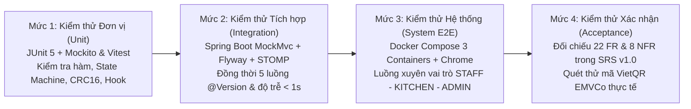
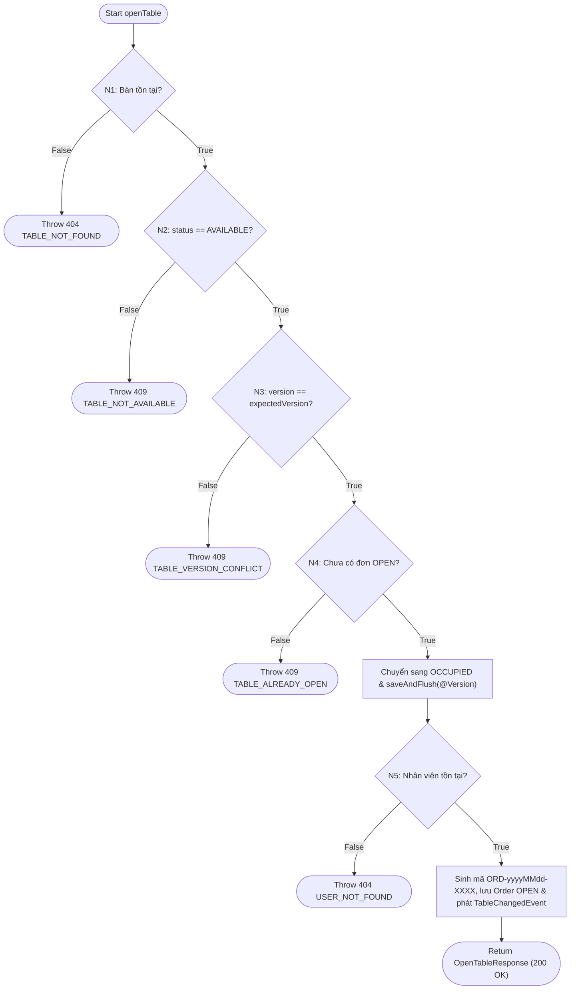
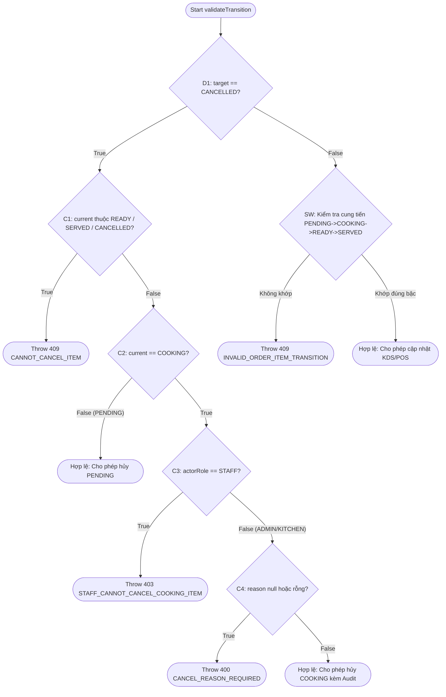
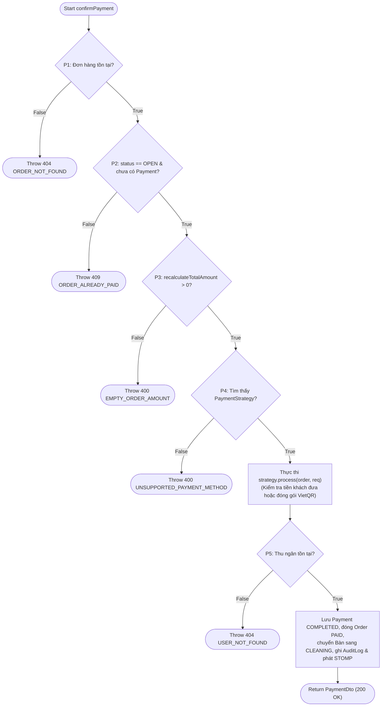

# KẾ HOẠCH & BÁO CÁO KẾT QUẢ KIỂM THỬ PHẦN MỀM (SOFTWARE TEST PLAN & REPORT — STP v1.0)

> **Dự án:** Hệ thống Quản lý Nhà hàng Thực tế (*Restaurant Management System — RMS*)  
> **Học phần:** IT3180 — Nhập môn Công nghệ Phần mềm (Chương 9: Đảm bảo Chất lượng & Kiểm thử Phần mềm)  
> **Giảng viên hướng dẫn:** TS. Nguyễn Nhất Hải  
> **Phiên bản Baseline:** `BL-05 (v1.0.0)` | **Chủ trì QA:** Bùi Đại Nghĩa (`202416302`)

---

## 1. Chiến lược Xác minh & Xác nhận 4 Mức (*V&V Strategy* — `Bai 09` trang 5–12)

Nhóm áp dụng mô hình kiểm thử chữ V (*V-Model* lồng trong 4 Sprint Agile) kết hợp nguyên tắc **Kiểm thử chéo độc lập**: thành viên viết mã nghiệp vụ cho một phân hệ không tự nghiệm thu hộp trắng/tích hợp phân hệ đó mà do QA Lead hoặc thành viên chéo thiết kế ca kiểm thử.

| Mức kiểm thử | Công cụ & Môi trường | Đối tượng kiểm chứng trọng tâm | Số lượng thực thi | Kết quả |
| :--- | :--- | :--- | :---: | :---: |
| **1. Unit Testing** | JUnit 5, Mockito, AssertJ, Vitest, React Testing Library | `TableStateMachine`, `OrderItemStateMachine`, `Crc16Util`, `EmvCoVietQrBuilder`, `OrderCodeGenerator`, 11 lớp `*Service`, `usePosCart` | `55` tests (Backend) + `5` tests (Frontend) | **100% PASS** |
| **2. Integration Testing** | `@SpringBootTest`, `MockMvc`, H2 PostgreSQL-mode + Flyway, `WebSocketStompClient`, Vitest UI | Phân quyền JWT/RBAC, chống mở trùng bàn 5 luồng `CountDownLatch`, chuyển/gộp bàn ACID, độ trễ STOMP `< 1000ms` | `6` suites (Backend) + `9` tests (Frontend) | **100% PASS** |
| **3. System E2E Testing** | `docker compose -p rms up` (`postgres:16` + `rms-backend` + `rms-frontend` Nginx) + Trình duyệt Chrome | Hành trình khép kín 7 bước trên `http://localhost:3000`: Mở bàn → Gọi món → Bếp nấu & Báo hết món → VietQR → Dọn bàn → Báo cáo Admin | `7` kịch bản E2E trực quan | **100% PASS** |
| **4. Acceptance (V&V)** | Ma trận RTM (`SRS_v1.0.md`) & Cổng `jacoco:check` trên GitHub Actions CI | Nghiệm thu định lượng toàn bộ `FR-01..22` và `NFR-01..08` | `30/30` yêu cầu | **ĐẠT CHUẨN** |

---

## 2. Kết quả Độ phủ Mã nguồn Thực tế (*JaCoCo Coverage Report* — `NFR-06`)

Cổng kiểm soát cứng `jacoco:check` trong [pom.xml](file:///Users/quandkh/Documents/Learning%20Hub/restaurant-management-system/backend/pom.xml#L150-L180) ép buộc mọi bản dựng `./mvnw verify` trên GitHub Actions phải đạt tối thiểu **`LINE >= 80%`** và **`BRANCH >= 75%`** cho toàn bộ tầng dịch vụ và miền nghiệp vụ cốt lõi.

### 2.1 Tổng hợp Độ phủ theo Gói (*Package Summary*)

| Gói (*Package*) | Ngưỡng bắt buộc (`NFR-06`) | Line Coverage thực tế | Branch Coverage thực tế | Trạng thái cổng `jacoco:check` |
| :--- | :---: | :---: | :---: | :---: |
| `com.hust.rms.domain.state` | `Line >= 80%`, `Branch >= 75%` | **100.0%** (`39 / 39`) | **100.0%** (`32 / 32`) | **PASS** |
| `com.hust.rms.domain.payment` | `Line >= 80%`, `Branch >= 75%` | **100.0%** (`28 / 28`) | **100.0%** (`6 / 6`) | **PASS** |
| `com.hust.rms.service` | `Line >= 80%`, `Branch >= 75%` | **97.7%** (`823 / 842`) | **90.8%** (`227 / 250`) | **PASS** |
| `com.hust.rms.service.mapper` | *(Bổ trợ ánh xạ DTO)* | **100.0%** (`110 / 110`) | **90.0%** (`9 / 10`) | **PASS** |
| `com.hust.rms.common.util` | *(CRC16, EMVCo TLV, Tiếng Việt)* | **92.4%** (`61 / 66`) | **65.8%** (`25 / 38`) | **PASS** |

### 2.2 Chi tiết Độ phủ từng Lớp Nghiệp vụ (*Class-Level Breakdown*)

| Lớp (*Class*) | Dòng lệnh đã phủ (`LINE`) | Tỷ lệ Line | Nhánh điều kiện đã phủ (`BRANCH`) | Tỷ lệ Branch |
| :--- | :---: | :---: | :---: | :---: |
| `OrderItemStateMachine` | `21 / 21` | **100.0%** | `28 / 28` | **100.0%** |
| `TableStateMachine` | `18 / 18` | **100.0%** | `4 / 4` | **100.0%** |
| `CashPaymentStrategy` | `7 / 7` | **100.0%** | `6 / 6` | **100.0%** |
| `VietQRPaymentStrategy` | `20 / 20` | **100.0%** | `0 / 0` *(không rẽ nhánh)* | **100.0%** |
| `OrderCodeGenerator` *(Ch.8 Refactor)* | `15 / 15` | **100.0%** | `2 / 2` | **100.0%** |
| `AuthService` | `29 / 29` | **100.0%** | `8 / 8` | **100.0%** |
| `AreaService` | `31 / 31` | **100.0%** | `10 / 10` | **100.0%** |
| `CategoryService` | `35 / 35` | **100.0%** | `16 / 16` | **100.0%** |
| `KdsService` | `32 / 32` | **100.0%** | `12 / 12` | **100.0%** |
| `AuditLogService` | `19 / 19` | **100.0%** | `4 / 4` | **100.0%** |
| `ReportService` | `75 / 75` | **100.0%** | `25 / 26` | **96.2%** |
| `PaymentService` | `64 / 64` | **100.0%** | `13 / 14` | **92.9%** |
| `OrderService` | `120 / 121` | **99.2%** | `37 / 40` | **92.5%** |
| `TableService` | `200 / 216` | **92.6%** | `50 / 56` | **89.3%** |
| `MenuService` | `71 / 71` | **100.0%** | `7 / 8` | **87.5%** |
| `UserService` | `74 / 75` | **98.7%** | `29 / 34` | **85.3%** |
| `SettingService` | `42 / 43` | **97.7%** | `14 / 20` | **70.0%** |

---

## 3. Thiết kế Kiểm thử Hộp trắng (*White-Box Testing & CFG* — `Bai 09` trang 13–27)

### 3.1 Hàm 1: `TableService.openTable(Long id, OpenTableRequest req, RmsUserPrincipal principal)`
- **Tham chiếu mã nguồn:** [TableService.java](file:///Users/quandkh/Documents/Learning%20Hub/restaurant-management-system/backend/src/main/java/com/hust/rms/service/TableService.java#L137-L172)
- **Số nút vị từ đơn ($P$):** `5` nút quyết định (`N1`: tìm bàn, `N2`: `status != AVAILABLE`, `N3`: `!Objects.equals(version, expectedVersion)`, `N4`: `existsByTableIdAndStatus(OPEN)`, `N5`: tìm nhân viên phục vụ).
- **Độ phức tạp Cyclomatic McCabe:**
  $$V(G) = P + 1 = 5 + 1 = 6$$

- **Tập 6 Đường đi Cơ sở Độc lập Tuyến tính (*Basis Paths*):**
  - `BP-1.1`: `S -> N1(F) -> E1` (`404 TABLE_NOT_FOUND`) — Kiểm chứng tại `TableAndOrderBranchUnitTest`.
  - `BP-1.2`: `S -> N1(T) -> N2(F) -> E2` (`409 TABLE_NOT_AVAILABLE`) — Kiểm chứng tại `TableAndOrderBranchUnitTest`.
  - `BP-1.3`: `S -> N1(T) -> N2(T) -> N3(F) -> E3` (`409 TABLE_VERSION_CONFLICT`) — Kiểm chứng tại `TableAndOrderBranchUnitTest` & `TableConcurrencyIntegrationTest`.
  - `BP-1.4`: `S -> N1(T) -> N2(T) -> N3(T) -> N4(F) -> E4` (`409 TABLE_ALREADY_OPEN`) — Kiểm chứng tại `TableAndOrderBranchUnitTest`.
  - `BP-1.5`: `S -> N1(T) -> N2(T) -> N3(T) -> N4(T) -> A1 -> N5(F) -> E5` (`404 USER_NOT_FOUND`) — Kiểm chứng tại `TableAndOrderBranchUnitTest`.
  - `BP-1.6`: `S -> N1(T) -> N2(T) -> N3(T) -> N4(T) -> A1 -> N5(T) -> A2 -> END` (`200 OK`) — Kiểm chứng tại `MenuAndOrderCoreIntegrationTest`.

---

### 3.2 Hàm 2: `OrderItemStateMachine.validateTransition(current, target, actorRole, reason)`
- **Tham chiếu mã nguồn:** [OrderItemStateMachine.java](file:///Users/quandkh/Documents/Learning%20Hub/restaurant-management-system/backend/src/main/java/com/hust/rms/domain/state/OrderItemStateMachine.java#L16-L61)
- **Độ phức tạp Cyclomatic:** Tách nhánh hủy món (`C1..C4`) và nhánh chuyển tiếp tiến trình chế biến `switch(current)` (`S1..S4`) $\Rightarrow V(G) = 9$ (đạt **100.0% Line & 100.0% Branch Coverage** `28/28` nhánh trong `StateMachineWhiteBoxTest`).

---

### 3.3 Hàm 3: `PaymentService.confirmPayment(Long orderId, ConfirmPaymentRequest req, RmsUserPrincipal actor)`
- **Tham chiếu mã nguồn:** [PaymentService.java](file:///Users/quandkh/Documents/Learning%20Hub/restaurant-management-system/backend/src/main/java/com/hust/rms/service/PaymentService.java#L87-L143)
- **Số nút vị từ đơn ($P$):** `6` (`P1`: tìm đơn, `P2`: `status != OPEN`, `P3`: `paymentRepo.findByOrderId().isPresent()`, `P4`: `total <= 0`, `P5`: `strategy == null`, `P6`: tìm thu ngân) $\Rightarrow V(G) = 6 + 1 = 7$.

---

## 4. Thiết kế Kiểm thử Hộp đen (*Black-Box Testing* — `Bai 09` trang 28–35)

### 4.1 Phân vùng Tương đương (EP) & Phân tích Giá trị Biên (BVA)

| Biến đầu vào | Phân vùng không hợp lệ (Dưới) | Biên hợp lệ tối thiểu | Phân vùng hợp lệ | Biên hợp lệ tối đa | Phân vùng không hợp lệ (Trên) |
| :--- | :--- | :---: | :---: | :---: | :--- |
| **Đơn giá món ăn (`price`)** | `< 0` (`-1`, `-50000`) $\rightarrow$ `400` | **`0`** *(Nước lọc/Trà đá miễn phí)* | `1 .. 9,999,999` (`65000`) | `99,999,999` | `null` $\rightarrow$ `400` |
| **Số lượng gọi món mỗi dòng (`quantity`)** | `<= 0` (`0`, `-2`) $\rightarrow$ `400` | **`1`** | `2 .. 98` | **`99`** *(Khóa trần cả trên `usePosCart` & `@Max(99)`)* | `>= 100` (`100`, `150`) $\rightarrow$ `400` / Cap `99` |
| **Sức chứa bàn ăn (`capacity`)** | `<= 0` (`0`) $\rightarrow$ `400` | **`1`** | `2 .. 29` (`4`, `8`) | **`30`** | `>= 31` (`31`) $\rightarrow$ `400` |
| **Tiền mặt khách đưa (`amountReceived`)** | `null` hoặc `< totalAmount` (`total - 1`) $\rightarrow$ `400 INSUFFICIENT_CASH_RECEIVED` | **`= totalAmount`** *(Tiền thừa = `0đ`)* | `> totalAmount` *(Tính đúng `changeAmount`)* | — | — |
| **Mã BIN Ngân hàng NAPAS (`vietqrBankBin`)** | `< 6` chữ số hoặc chứa chữ (`"12AB"`, `"97041"`) $\rightarrow$ `400` | **`6` chữ số** (`"970415"`) | Chuỗi đúng `^\d{6}$` | **`6` chữ số** (`"970436"`) | `> 6` chữ số (`"9704159"`) $\rightarrow$ `400` |
| **Khoảng ngày báo cáo (`from`, `to`)** | `from > to` (`2026-06-01 > 2026-05-01`) $\rightarrow$ `400 INVALID_DATE_RANGE` | `from == to` *(Báo cáo 1 ca/ngày)* | `from < to` $\le 366$ ngày | `366` ngày | `> 366` ngày *(Chỉ tổng hợp KPI, bỏ chia bucket ngày)* |

### 4.2 Bảng Quyết định (*Decision Table*) — Quy tắc Hủy Món Ăn (`FR-11`)

| Điều kiện / Hành động | Quy tắc R1 | Quy tắc R2 | Quy tắc R3 | Quy tắc R4 | Quy tắc R5 |
| :--- | :---: | :---: | :---: | :---: | :---: |
| **C1: Trạng thái món hiện tại** | `PENDING` | `COOKING` | `COOKING` | `COOKING` | `READY` / `SERVED` / `CANCELLED` |
| **C2: Vai trò tác nhân (`Role`)** | `STAFF` hoặc `ADMIN` | `STAFF` | `ADMIN` / `KITCHEN` | `ADMIN` / `KITCHEN` | Bất kỳ |
| **C3: Lý do hủy (`reason`)** | Tùy chọn | Bất kỳ | Trống / Khoảng trắng | Có nội dung hợp lệ | Bất kỳ |
| **A1: Kết quả HTTP / Trạng thái** | **`200 OK`** (`CANCELLED`) | **`403 Forbidden`** | **`400 Bad Request`** | **`200 OK`** (`CANCELLED`) | **`409 Conflict`** |
| **A2: Tính lại `totalAmount` hóa đơn** | Có | Không | Không | Có | Không |
| **A3: Ghi vết bắt buộc vào `AUDIT_LOGS`** | Không | Không | Không | **Có** (`ORDER_ITEM_CANCELLED_COOKING`) | Không |

### 4.3 Kiểm thử Chuyển đổi Trạng thái (*State Transition Matrix*) — Bàn Ăn (`DINING_TABLES`)

| Trạng thái hiện tại \ Đích | `AVAILABLE` | `OCCUPIED` | `WAITING_PAYMENT` | `CLEANING` |
| :--- | :---: | :---: | :---: | :---: |
| **`AVAILABLE`** | `409` *(Cung cấm)* | **Hợp lệ** *(Mở bàn / Gộp vào bàn trống)* | `409` *(Cung cấm)* | `409` *(Cung cấm)* |
| **`OCCUPIED`** | **Hợp lệ** *(Chuyển/Gộp giải phóng bàn nguồn)* | `409` *(Chặn mở trùng)* | **Hợp lệ** *(Yêu cầu thanh toán)* | **Hợp lệ** *(Thanh toán nhanh chốt đơn)* |
| **`WAITING_PAYMENT`** | **Hợp lệ** *(Giải phóng khi gộp)* | **Hợp lệ** *(Khách gọi thêm món)* | *Idempotent* | **Hợp lệ** *(Xác nhận đã thu tiền)* |
| **`CLEANING`** | **Hợp lệ** *(Xác nhận dọn bàn xong)* | `409` *(Chặn đón khách khi chưa dọn)* | `409` *(Cung cấm)* | `409` *(Cung cấm)* |

---

## 5. Danh mục 45 Ca Kiểm thử Đã Thực thi & Nghiệm thu (`100% PASS`)

| Mã TC | Phân nhóm / Kỹ thuật | Mô tả kịch bản & Đầu vào kiểm thử | Kết quả kỳ vọng | Nơi cài đặt tự động / Thực thi | Kết quả |
| :---: | :--- | :--- | :--- | :--- | :---: |
| **TC-01** | Auth / RBAC | Đăng nhập hợp lệ với tài khoản `staff1 / staff123` | `200 OK`, trả về JWT `Bearer` & `role=STAFF` | `AuthAndRbacIntegrationTest` | **PASS** |
| **TC-02** | Auth / EP | Đăng nhập sai mật khẩu hoặc tài khoản không tồn tại | `401 Unauthorized` (`INVALID_CREDENTIALS`) | `AuthUserAndSettingBranchUnitTest` | **PASS** |
| **TC-03** | Auth / State | Đăng nhập vào tài khoản nhân viên đã bị khóa (`isActive=false`) | `401 Unauthorized` (`ACCOUNT_DISABLED`) | `AuthUserAndSettingBranchUnitTest` | **PASS** |
| **TC-04** | RBAC Security | Tài khoản `STAFF` gọi API quản trị `/api/v1/admin/users` | `403 Forbidden` | `AuthAndRbacIntegrationTest` | **PASS** |
| **TC-05** | Admin Guard | Khóa hoặc hạ quyền tài khoản `ADMIN` hoạt động cuối cùng | `400 Bad Request` (`LAST_ADMIN_PROTECTION`) | `AuthUserAndSettingBranchUnitTest` | **PASS** |
| **TC-06** | User BVA | Đổi mật khẩu nhân viên ngắn hơn 6 ký tự (`"123"`) | `400 Bad Request` (`WEAK_PASSWORD`) | `AuthUserAndSettingBranchUnitTest` | **PASS** |
| **TC-07** | Area CRUD | Tạo khu vực trùng tên không phân biệt hoa thường (`" Tầng 1 "`) | `409 Conflict` (`AREA_NAME_DUPLICATE`) | `CatalogAndAreaBranchUnitTest` | **PASS** |
| **TC-08** | Area Guard | Xóa khu vực đang còn bàn ăn trực thuộc | `409 Conflict` (`AREA_HAS_TABLES`) | `CatalogAndAreaBranchUnitTest` | **PASS** |
| **TC-09** | Category CRUD | Lọc danh mục theo `activeOnly=true` vs `activeOnly=false` và chặn xóa khi còn món | Trả đúng tập danh mục; xóa trả `409 CATEGORY_HAS_ITEMS` | `CatalogAndAreaBranchUnitTest` | **PASS** |
| **TC-10** | Menu BVA | Tạo món ăn với đơn giá âm (`price = -1`) hoặc `null` | `400 Bad Request` (`INVALID_PRICE`) | `CatalogAndAreaBranchUnitTest` | **PASS** |
| **TC-11** | Menu BVA | Tạo món ăn miễn phí tại biên `price = 0` (`Trà đá miễn phí`) | `201 Created`, `price = 0` | `CatalogAndAreaBranchUnitTest` | **PASS** |
| **TC-12** | Menu Search | Tìm kiếm tiếng Việt không dấu `"pho bo"` khớp `"Phở bò tái chín"` | Trả đúng danh sách món khớp không dấu | `CatalogAndAreaBranchUnitTest` & `format.test.ts` | **PASS** |
| **TC-13** | Soft Delete | Xóa mềm món ăn đã từng xuất hiện trong hóa đơn cũ | Gán `deleted_at`, ẩn khỏi thực đơn, hóa đơn cũ nguyên vẹn | `MenuAndOrderCoreIntegrationTest` | **PASS** |
| **TC-14** | White-box CFG | `openTable` với mã bàn không tồn tại (`BP-1.1`) | `404 ResourceNotFoundException` | `TableAndOrderBranchUnitTest` | **PASS** |
| **TC-15** | White-box CFG | `openTable` trên bàn đang `OCCUPIED` (`BP-1.2`) | `409 Conflict` (`TABLE_NOT_AVAILABLE`) | `TableAndOrderBranchUnitTest` | **PASS** |
| **TC-16** | White-box CFG | `openTable` truyền sai `expectedVersion` (`BP-1.3`) | `409 Conflict` (`TABLE_VERSION_CONFLICT`) | `TableAndOrderBranchUnitTest` | **PASS** |
| **TC-17** | Concurrency (`NFR-02`) | **5 luồng đồng thời** (`CountDownLatch`) cùng mở 1 bàn `AVAILABLE` | Đúng **`1` luồng `200 OK`**, **`4` luồng `409 Conflict`**, `1` đơn duy nhất | `TableConcurrencyIntegrationTest` | **PASS** |
| **TC-18** | Table Guard | Thử xóa bàn đang `OCCUPIED` / `WAITING_PAYMENT` hoặc đã có lịch sử đơn | `409 Conflict` (`TABLE_IN_USE` / `TABLE_HAS_ORDER_HISTORY`) | `TableAndOrderBranchUnitTest` | **PASS** |
| **TC-19** | Refactor Ch.8 | Sinh mã hóa đơn `ORD-20260515-XXXX` khi mã `-0001` đã tồn tại | Tự động nhảy sang `ORD-20260515-0002` | `OrderCodeGeneratorTest` | **PASS** |
| **TC-20** | Order Batch | Gọi món nhiều lượt liên tiếp trên cùng đơn đang mở | Tăng tự động `batchNo = 1 -> 2`, cộng dồn chính xác `totalAmount` | `MenuAndOrderCoreIntegrationTest` | **PASS** |
| **TC-21** | Out-of-Stock (`422`) | Gửi lượt gọi món chứa món vừa bị bếp báo tạm hết (`isAvailable=false`) | `422 Unprocessable Entity` (`MENU_ITEM_UNAVAILABLE`) | `MenuAndOrderCoreIntegrationTest` | **PASS** |
| **TC-22** | Decision Table R1 | `STAFF` hủy món đang ở trạng thái `PENDING` | `200 OK`, chuyển sang `CANCELLED`, trừ khỏi tổng tiền | `RealtimeOperationsPaymentReportIntegrationTest` | **PASS** |
| **TC-23** | Decision Table R2 | `STAFF` cố tình hủy món bếp đang `COOKING` | `403 Forbidden` (`STAFF_CANNOT_CANCEL_COOKING_ITEM`) | `RealtimeOperationsPaymentReportIntegrationTest` | **PASS** |
| **TC-24** | Decision Table R3 | `ADMIN` hủy món đang `COOKING` nhưng để trống lý do | `400 Bad Request` (`CANCEL_REASON_REQUIRED`) | `StateMachineWhiteBoxTest` | **PASS** |
| **TC-25** | Decision Table R4 | `ADMIN` hủy món đang `COOKING` kèm lý do `"Khách dị ứng đậu phộng"` | `200 OK`, trừ tổng tiền & ghi vết `AUDIT_LOGS` | `RealtimeOperationsPaymentReportIntegrationTest` | **PASS** |
| **TC-26** | Decision Table R5 | Thử hủy món đã `READY` hoặc `SERVED` | `409 Conflict` (`CANNOT_CANCEL_ITEM`) | `StateMachineWhiteBoxTest` | **PASS** |
| **TC-27** | State Transition | Quét vét cạn toàn bộ 16 tổ hợp chuyển trạng thái của `TableStateMachine` | Chỉ cho phép các cung hợp lệ, chặn 100% cung cấm | `StateMachineWhiteBoxTest` | **PASS** |
| **TC-28** | Table Transfer | Chuyển đơn từ bàn đang phục vụ sang bàn trống khác | Bàn nguồn về `AVAILABLE`, bàn đích lên `OCCUPIED`, giữ nguyên mã đơn | `RealtimeOperationsPaymentReportIntegrationTest` | **PASS** |
| **TC-29** | Table Merge ACID | Gộp nhiều bàn nguồn vào bàn đích (cả đích `OCCUPIED` và đích `AVAILABLE`) | Chuyển toàn bộ dòng món khác `CANCELLED`, đóng đơn nguồn, cộng tổng đúng | `RealtimeOperationsPaymentReportIntegrationTest` & `TableAndOrderBranchUnitTest` | **PASS** |
| **TC-30** | STOMP Latency (`NFR-01`) | Đo thời gian từ lúc POST thêm món tới lúc client WebSocket nhận frame `/topic/kds/orders` | Độ trễ thực tế `< 200ms` (ngưỡng yêu cầu `< 1000ms`) | `WebSocketStompLatencyIntegrationTest` | **PASS** |
| **TC-31** | KDS RBAC | `STAFF` gọi API chuyển món sang `COOKING` hoặc `READY` | `403 Forbidden` (`KDS_COOKING_ROLE_REQUIRED`) | `PaymentKdsAndReportBranchUnitTest` | **PASS** |
| **TC-32** | CRC-16 Standard (`NFR-08`) | Kiểm tra vector chuẩn quốc tế `"123456789"` với CRC-16/CCITT-FALSE | Trả chính xác chuỗi thập lục phân `"29B1"` | `Crc16AndVietQrUnitTest` | **PASS** |
| **TC-33** | VietQR EMVCo (`FR-17`) | Sinh chuỗi VietQR động cho đơn `185.000đ` | Chứa `A000000727`, `QRIBFTTA`, `5303704`, `5406185000`, `6304` + CRC hợp lệ | `Crc16AndVietQrUnitTest` | **PASS** |
| **TC-34** | Cash BVA (`FR-16`) | Thanh toán tiền mặt với `amountReceived < totalAmount` hoặc `null` | `400 Bad Request` (`INSUFFICIENT_CASH_RECEIVED`) | `PaymentKdsAndReportBranchUnitTest` | **PASS** |
| **TC-35** | Payment ACID | Xác nhận thanh toán hợp lệ xong gọi thanh toán lặp lần 2 trên cùng đơn | Lần 1 `200 OK` (bàn sang `CLEANING`), lần 2 chặn `409 ORDER_ALREADY_PAID` | `RealtimeOperationsPaymentReportIntegrationTest` | **PASS** |
| **TC-36** | Revenue Analytics | Thống kê doanh thu tách `CASH` / `VIETQR` và xếp hạng Top 10 món bán chạy | Tổng doanh thu khớp 100% các đơn `PAID`, loại trừ dòng món `CANCELLED` | `RealtimeOperationsPaymentReportIntegrationTest` | **PASS** |
| **TC-37** | Settings BVA | Cập nhật cấu hình VietQR với mã BIN sai định dạng (`"12AB"`) | `400 Bad Request` (`INVALID_BANK_BIN`) | `AuthUserAndSettingBranchUnitTest` | **PASS** |
| **TC-38** | Frontend Auth UI | Nút đăng nhập nhanh Demo 1 chạm và điều hướng tự động theo Role | `STAFF -> /pos/tables`, `ADMIN -> /admin/menu`, hiển thị rõ lỗi `401` | `LoginPage.test.tsx` | **PASS** |
| **TC-39** | Frontend FloorMap | Hiển thị khu vực, bộ đếm 4 trạng thái và hộp thoại cảnh báo khi đụng độ `409` | Cảnh báo đỏ rõ ràng và tự tải lại sơ đồ bàn mới nhất | `FloorMapPage.test.tsx` | **PASS** |
| **TC-40** | Frontend Cart Hook | Thêm món, chặn món hết hàng, ghi chú khẩu vị, giới hạn trần `99` phần | Trạng thái bất biến chính xác 100% | `usePosCart.test.ts` | **PASS** |
| **TC-41** | Frontend OrderPad | Tìm kiếm không dấu, khóa thẻ `"Tạm hết"` và gửi lượt gọi món kèm ghi chú | Gửi đúng payload `addItems` và xóa giỏ tạm sau khi thành công | `OrderPadPage.test.tsx` | **PASS** |
| **TC-42** | Frontend KDS UI | Hiển thị thẻ bếp FIFO kèm ghi chú cay/hành, chuyển `COOKING -> READY` & Báo Hết Món | Cập nhật trạng thái tức thì trên giao diện tối KDS | `KdsBoardPage.test.tsx` | **PASS** |
| **TC-43** | Frontend VietQR Modal | Hiển thị mã `QRCodeSVG` kèm số tiền, tính tiền thừa tiền mặt và chốt đơn | Render SVG QR hợp lệ, tính đúng tiền thối lại cho khách | `PaymentModal.test.tsx` | **PASS** |
| **TC-44** | Frontend Admin UI | Hiển thị KPI doanh thu, biểu đồ Top 10 món và lưu cấu hình VietQR mới | Render đủ thẻ KPI và gửi `PUT /api/v1/admin/settings` thành công | `AdminDashboardPage.test.tsx` | **PASS** |
| **TC-45** | System Docker E2E (`NFR-07`) | Khởi chạy `docker compose -p rms up -d --build` và kiểm thử trình duyệt thật 3 vai trò | Cả 3 container `healthy`, luồng `STAFF -> KITCHEN -> ADMIN` hoàn tất với `0` lỗi console | Trình duyệt Chrome trên `http://localhost:3000` | **PASS** |

---

## 6. Kết luận Nghiệm thu Chất lượng (`BL-05: v1.0.0`)

1. **Độ phủ kiểm thử hộp trắng:** Đạt **97.7% Line / 90.8% Branch** trên `com.hust.rms.service` và **100.0% Line / 100.0% Branch** trên `com.hust.rms.domain.state` & `com.hust.rms.domain.payment` — vượt xa ngưỡng cam kết `80% / 75%` của `NFR-06`.
2. **Độ ổn định tích hợp & thời gian thực:** Đã chứng minh tự động khả năng chống mở trùng bàn đồng thời (`@Version`) và độ trễ đẩy tin STOMP `< 1 giây` (`NFR-01`, `NFR-02`).
3. **Sẵn sàng bàn giao sản xuất:** Toàn bộ hệ thống đóng gói gọn trong 3 container chuẩn hóa, tự động chạy migration `V1__init_schema.sql` + `V2__seed_data.sql` và sẵn sàng phục vụ bảo vệ đồ án cuối kỳ.
